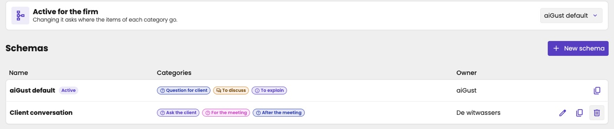
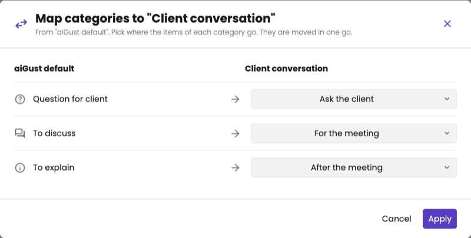

A category is a column on the [follow-up board](/guide/follow-up/overview#the-board). Categories group what still needs to happen, such as *Ask the client* or *Discuss in the meeting*.

<Note>
Only key users can manage follow-up categories.
</Note>

Categories come in a **schema**: a named set of categories in a fixed order. aiGust provides a default schema, and your firm can build its own. One schema is active at a time. The active schema applies to every administration of your firm.

## Open the settings

Click **Settings** in the firm menu, and choose **Follow-up categories** under **Reporting**.

The **Active for the firm** card at the top shows the active schema. The **Schemas** table below lists every schema with its **Name**, its **Categories** and its **Owner**: your firm or **aiGust**. The active schema carries an **Active** badge.

<Frame caption="The follow-up categories of the firm.">
  
</Frame>

## Create a schema

<Steps>
  <Step title="Create the schema">
    Click **New schema** and enter a **Name**. Use **nl**, **en** and **fr** to enter the name in each language.
  </Step>
  <Step title="Add the categories">
    Under **Categories (board columns, in this order)**, click **Add category** for each category you need. Per category:

    - Click the colour circle to pick a **Color**.
    - Pick an **Icon**.
    - Enter the **Label** in each language.

    The badge under the row previews how the category looks on the board. Move a category with the arrows: the order here is the column order on the board. Remove one with the bin.
  </Step>
  <Step title="Save the schema">
    Click **Save**. The button stays greyed out until the schema has a name and at least one category, and every category has a label.
  </Step>
</Steps>

<Frame caption="Create a schema: the name in three languages, and the categories in board order.">
  
</Frame>

<Note>
**No category** always exists as the first board column. You can't change or remove it.
</Note>

## Edit, duplicate or delete a schema

On the schema's row in the table:

| Button | What it does |
|---|---|
| Pencil — **Edit schema** | Opens the same side panel as **New schema**, to change the name and the categories. Only for your firm's own schemas. |
| Copy — **Duplicate schema** | Copies the schema as a new, inactive schema with ` (copy)` behind its name. Handy to start from the aiGust default. |
| Bin — **Delete schema** | Deletes the schema after you confirm. Only for your firm's own schemas that aren't active. This cannot be undone. |

## Switch the active schema

Pick another schema on the **Active for the firm** card. Before aiGust switches, it asks where the items of each category go, in **Map categories to "{name}"**. For every category of the current schema, pick a category of the new one. Items you don't map move to **No category**.

Click **Apply** to move all items in one go and activate the new schema.

<Frame caption="Map the categories of the current schema to the new one.">
  
</Frame>
