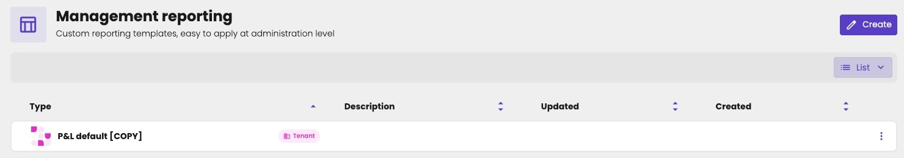

[Management reports](/guide/reports/management-reports/overview) are financial reports you build yourself. Most are built for one administration. When many administrations need the same report, for example a profit and loss for restaurants, build it once in your firm's library.

<Note>
Only key users can create and change library reports.
</Note>

Click **Settings** in the main rail, and choose **Management reporting**. The list shows your firm's library reports, marked **Tenant**.

<Frame caption="The management report library of your firm.">
  
</Frame>

## Create a library report

It works as for a [report in an administration](/guide/reports/management-reports/overview#create-a-management-report), with fewer ways to start:

1. Click **Create**.
2. Choose how to start:
   - **Start from scratch:** an empty report.
   - **Copy an existing report:** an aiGust standard report, such as **P&L default**, or another report of your library (**Tenant**). You can't copy a report of an administration here.
3. Click **Next**.
4. Enter a **Title**, and optionally a **Description**, in each language: **NL**, **EN** and **FR**. Click **Translate** to translate them into the other languages automatically.
5. Click **Create**.

There's no **Link a tenant template** here: you link a library report from the administration, not from the library.

## Build a library report

You build a library report in the same [editor](/guide/reports/management-reports/editor) as in an administration, with two differences:

- **Only the Definition tab.** A library report isn't tied to an administration, so it has no figures, and no **Table** tab.
- **The account check uses the aiGust chart of accounts**: the plan behind the aiGust [labels](/guide/concepts/labels), not the chart of accounts of an administration. See [Check the accounts](/guide/reports/management-reports/line-items#check-the-accounts).

<Frame caption="A library report in the editor: only the definition, marked Tenant.">
  
</Frame>

## Copy or link

Accountants use a library report in an administration in one of two ways:

- **Copy an existing report:** the administration gets its own copy, which they can change freely. Later changes to the library report don't affect the copy.
- **Link a tenant template:** the administration uses the library report itself, marked **Read only**. Nobody can change it in the administration. When you change the library report, the change applies to every administration that links to it.

See [Use a report from the library](/guide/reports/management-reports/overview#use-a-report-from-the-library).

## Change a library report

Your changes apply right away to every administration that links to the report. Administrations with a copy keep their own version.

## Delete a library report

When you delete a library report, it disappears from every administration that links to it. Administrations that copied it keep their copy.

KPI cards on a dashboard that used a line of the deleted report show that the KPI can no longer be found. See [Use a line as a KPI on the dashboard](/guide/reports/management-reports/overview#use-a-line-as-a-kpi-on-the-dashboard).

## Management reports in meeting flows

In a [meeting flow](/configure/meetings/meeting-flows), the [Management report widget](/guide/meetings/widgets/management-report#in-a-meeting-flow) can show a library report. Every meeting from the flow then shows it, also for administrations the report isn't linked to. Or you leave the choice to the accountant, in each meeting.
