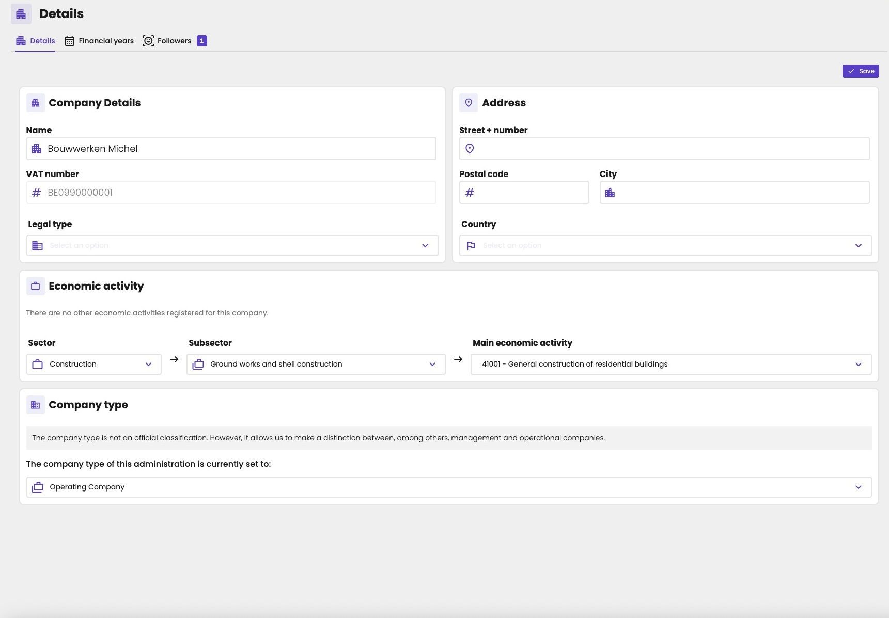
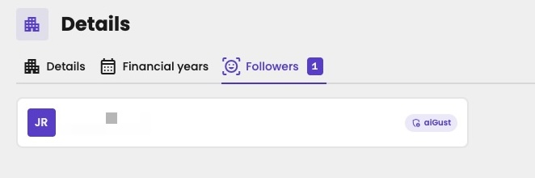
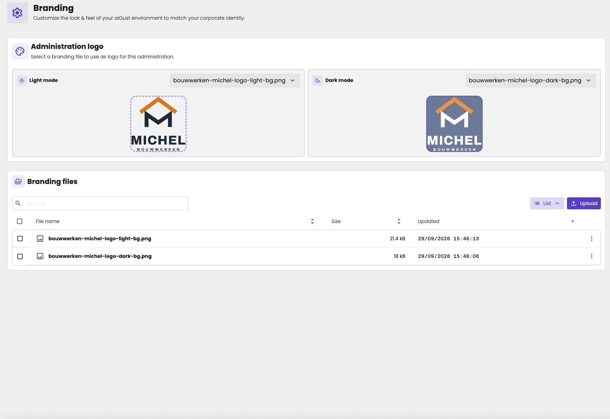

Each administration has its own details and branding. You find them under **Settings** in the administration menu, in **Details** and **Branding**. **Settings** is collapsed by default: click it to open it.

Every accountant with access to the administration can change these.

## Details

**Details** has three tabs:

- **Details:** the general properties of the administration. See below.
- **Financial years:** how aiGust has split the administration's years into periods. See [Financial periods](/guide/concepts/financial-periods).
- **Followers:** the users who [follow](/guide/getting-started/navigation#follow-the-administrations-you-work-on) the administration.

On the **Details** tab, change what you need, and click **Save** at the top right.

<Frame caption="The details of an administration.">
  
</Frame>

| Section | What it holds |
|---|---|
| **Company Details** | **Name**, **VAT number** and **Legal type**. The VAT number comes from the bookkeeping system, so you can't change it here. |
| **Address** | **Street + number**, **Postal code**, **City** and **Country**. |
| **Economic activity** | **Sector**, **Subsector** and **Main economic activity**. They decide the administration's sector. |
| **Company type** | Such as a management company or an operating company. |

For the sector and the company type, see [Sectors and company types](/guide/concepts/sectors-and-company-types).

<Frame caption="The users who follow the administration.">
  
</Frame>

A follower marked **aiGust** is a user of the aiGust team. You don't see the badge for the users at your firm.

## Branding

**Branding** holds the logo of the administration, and the branding files it comes from.

<Frame caption="The branding of an administration: its logo and its branding files.">
  
</Frame>

### Branding files

The branding files are the images of an administration, such as its logo.

1. Go to **Settings** › **Branding**.
2. Under **Branding files**, click **Upload**.
3. In **Upload branding files**, select a file, or drag and drop it. You can upload PNG, JPG and WebP files.
4. Click **Next**.

## The administration's logo

1. Upload the logo under **Branding files**.
2. Under **Administration logo**, on the same page, choose a branding file for **Light mode**, and one for **Dark mode**. A preview shows how each looks.

aiGust shows the logo:

- **In the list of administrations.**
- **In the administration menu,** next to the administration's name at the top.
- **In meetings,** if you turn on **Show administration logo**. See [Your client's logo](/guide/meetings/customize#your-clients-logo).

### What makes a good logo

- **Square.** aiGust shows the logo as a square icon.
- **Without a background.** Use a PNG or WebP with a transparent background, not a JPG.
- **One for each mode.** A logo with dark text disappears on a dark background. Upload a light version for **Dark mode**.
