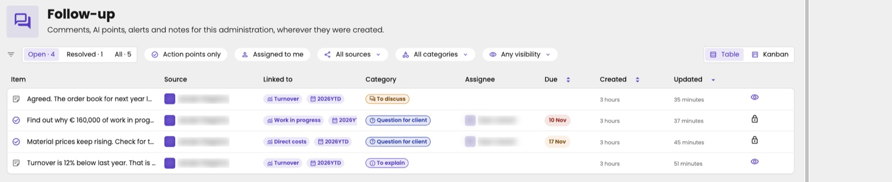
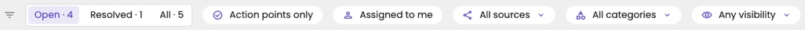
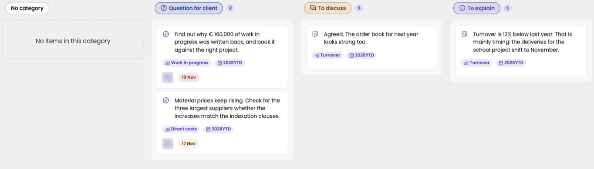

The **Follow-up** page gathers every comment thread of an administration, wherever it was created: a comment on a figure, a meeting note, a point from the AI assistant, or an alert. Use it as the to-do list of the administration: what still needs an answer, an action or a discussion.

Click **Follow-up** in the administration menu. The page opens on the **Open** tab: the items that still need attention.

<Frame caption="The Follow-up page, in the table view.">
  
</Frame>

## Where the items come from

Every item is a comment thread. The **Source** shows who or what started it:

| Source | Started by |
|---|---|
| A colleague, with their name and avatar | A person, for example with a [comment on a figure](/guide/reports/comments) or a [meeting note](/guide/meetings/notes-and-summaries) |
| **AI** | The AI assistant |
| **Alert** | An [alert](/guide/triggers/alerts) raised by a trigger |
| A name with a link icon | Another system, synced through a connector |

## Find the items you need

Use the filter bar at the top to narrow the list. The filters work together, and the numbers on the tabs follow them.

| Filter | What it shows |
|---|---|
| **Open**, **Resolved**, **All** | Items that still need attention, items that are dealt with, or everything. The number on each tab is how many items it has. |
| **Action points only** | Only items marked as something someone still has to do. |
| **Assigned to me** | Only items assigned to you. |
| **All sources** | Only items of one source: **User**, **AI** or **External**. |
| **All categories** | Only items in one category: the columns of the [board](#the-board). |
| **Any visibility** | Only **Public** items (visible to your client) or only **Internal** items (within your firm). |

<Frame caption="The filter bar.">
  
</Frame>

<Tip>
The filters live in the page address. Bookmark a filtered view or copy the address to send it to a colleague.
</Tip>

## Choose your view

At the top right, switch between **Table** and **Kanban**.

### The table

The table lists the most recently updated items first. Click a column header to sort by **Due**, **Created** or **Updated**.

| Column | What you see |
|---|---|
| **Item** | The first line of the thread. A check mark means action point, a note icon means remark. The text is bold when there are replies you haven't read, and struck through once the item is resolved. |
| **Source** | Who or what started the thread. See [Where the items come from](#where-the-items-come-from). |
| **Linked to** | Where the thread was started: an account, a KPI, a meeting slide, a label, a customer or supplier, or a forecast scenario. **General** means it isn't linked to anything. |
| **Category** | The [board](#the-board) column the item belongs to. |
| **Assignee** | Who has to do it, for action points. |
| **Due** | The due date, for action points. It turns orange within a week of the date, and red once the date has passed. |
| **Created** | When the thread was started. |
| **Updated** | When the thread was last active: a change or a new reply. |
| Eye or lock icon | **Visible to the client** or **Internal only**. |
| Speech bubble | The number of replies. |

Click a row to open [the thread details](#the-thread-details).

### The board

The board shows the same items as cards, grouped in columns: **No category** first, then one column per category of your firm. The number next to a column title is how many items it holds.

Drag a card to another column to change its category. Click a card to open [the thread details](#the-thread-details).

<Frame caption="The board, with one column per category.">
  
</Frame>

A key user sets up the categories and their order. See [Follow-up categories](/configure/follow-up/categories).

## The thread details

Click a row or a card to open the thread in a side panel. Opening it also marks it as read.

<Frame caption="The side panel of an overdue action point.">
  
</Frame>

At the top you see who started the thread, when it was created and when it was last updated. Below that:

| Setting | What it does |
|---|---|
| **Status** | **Open**, or **Resolved on** a date. |
| **Type** | **Action point** (something someone still has to do) or **Note** (a remark). |
| **Visibility** | **Internal** (within your firm) or **Client** (visible in the [client portal](/guide/client-portal/client-view)). |
| **Category** | The [board](#the-board) column of the item. |
| **Linked to** | Where the thread was started, or **General**. |

An action point has two more settings:

- **Assignee**: who has to do it. **Unassigned** means nobody yet.
- **Due date**: when it should be done. Passed the date, the item gets an **Overdue** badge. Pick **Clear due date** to remove it.

Change any of these directly in the panel. Your client can't: client users only read and reply.

Under the settings you read the original text and the replies. Reply at the bottom: **Reply to your team (internal)** on an internal thread, or **Reply (visible to the client)** on a public one. Replies always follow the visibility of the thread.

## Resolve an item

Dealt with an item? Click **Mark as resolved** at the top right of its side panel. The item moves to the **Resolved** tab. To reopen it, find it there and click **Mark as unresolved**.
