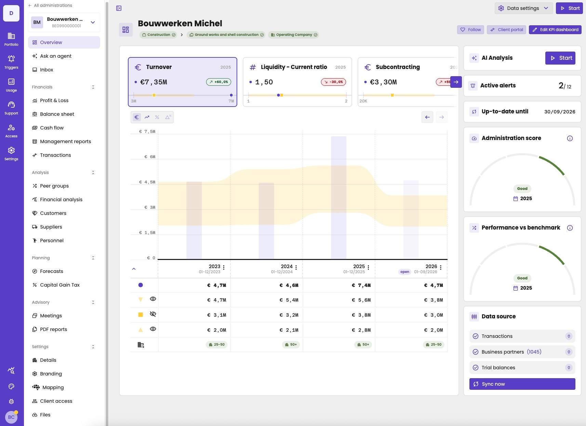
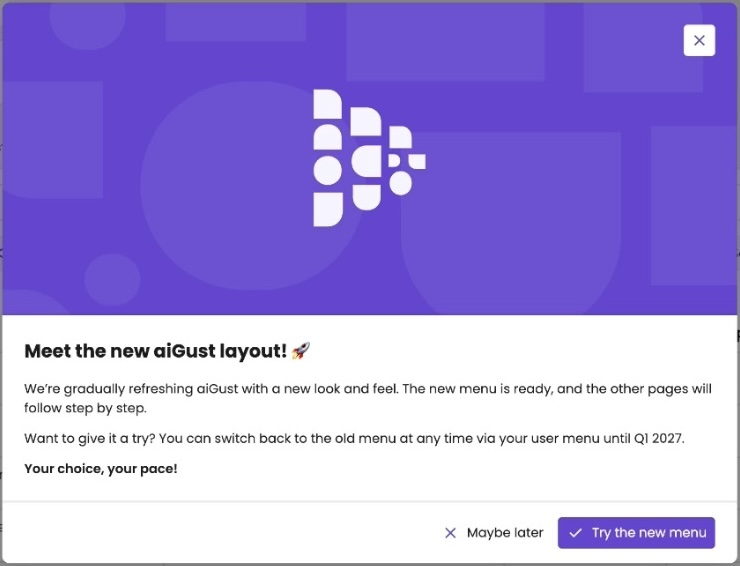
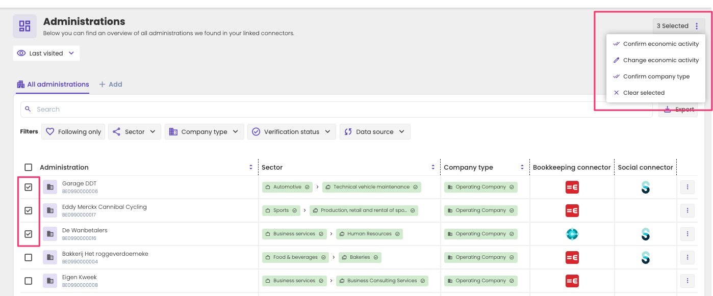
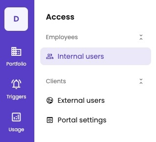
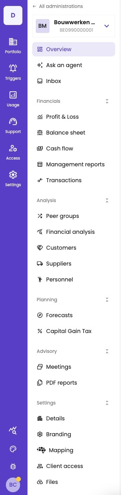
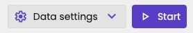

aiGust has two levels:

- **Your firm:** the administrations of all your clients, and the settings of your firm.
- **One administration:** the figures, reports, meetings and forecasts of one client.

On the left, the **main rail** is always the same, wherever you are. Next to it, a second menu changes with where you are: the items of the firm, or the menu of the administration you opened.

<Frame caption="The new layout, inside an administration: the main rail, the administration menu, and the dashboard.">
  
</Frame>

## The new and the legacy layout

aiGust has a new layout. We're refreshing aiGust step by step: the new menu is ready, and the other pages follow.

The first time you open aiGust, it asks whether you want to try the new layout. Click **Try the new menu** to switch, or **Maybe later** to keep the legacy layout. After you choose, aiGust normally doesn't ask again.

<Frame caption="aiGust asks whether you want to try the new layout.">
  
</Frame>

You can switch between the new and the legacy layout at any time, with **Use new menu** in your [user menu](#your-user-menu). Both layouts are available until the first quarter of 2027.

This documentation describes the new layout. Still using the legacy layout? See [Where did it go?](#where-did-it-go) to find a page in the new layout.

## Find an administration

After you sign in, you land on **Administrations**: the list of the administrations aiGust found in your firm's connectors. It's your home page. You get back to it with **Portfolio** › **Administrations** in the main rail, or with the back button in the administration menu.

<Frame caption="The list of administrations, where you land after signing in.">
  
</Frame>

Click an administration to open it.

You see all administrations of your firm, unless a key user limited your access to some of them. You then only see those, here and everywhere else in aiGust. See [Restrict administration access](/setup/users/restrict-access).

### Last visited and most visited

At the top, aiGust shows the administrations you opened recently, so you get back to them in one click. The first time you sign in, this is still empty. It fills up as soon as you open administrations.

Choose **Last visited** or **Most visited** in the list above them. aiGust remembers your choice for the next time.

### Search and filter

Type in **Search** to find an administration by its name, VAT number, sector or subsector. To narrow down the list, use the filters:

| Filter | Shows |
|---|---|
| **Following only** | Only the administrations you follow. See [Follow an administration](#follow-an-administration). |
| **Sector** | The administrations in one or more [sectors](/guide/concepts/sectors-and-company-types). |
| **Company type** | The administrations of one or more company types. |
| **Verification status** | Whether the sector and company type are verified. Use it to find administrations you still need to [check](/guide/getting-started/first-steps). |
| **Data source** | The administrations from one [connector](/guide/dashboard/data-sync). |
| **Social balance source** | The administrations from one [social connector](/setup/data/social/overview). |

Click **Export** to download the list.

### Verify the sector and company type of many administrations

In the list, the sector, subsector and company type of each administration show whether they're verified: with a check mark, in green. To verify or change them for many administrations at once:

1. Select the administrations with the check boxes.
2. Click **Selected** at the top right, for example **3 Selected**.
3. Choose what to do:
   - **Confirm economic activity**, to verify the sector and subsector;
   - **Change economic activity**, to give them all another economic activity;
   - **Confirm company type**;
   - **Clear selected**, to clear the selection.

<Frame caption="Confirm the economic activity of three administrations at once.">
  
</Frame>

For what the sector and company type mean, see [Sectors and company types](/guide/concepts/sectors-and-company-types).

### Follow the administrations you work on

Most of the time, you only work on part of your firm's administrations. Follow them, like starring an email, to find them quickly:

- **In the list,** click the heart next to an administration, or click the three dots and choose **Follow**. For an administration you follow, the menu shows **Following**: click it to stop following.
- **In an administration,** click **Follow** at the top of its [dashboard](/guide/dashboard/dashboard#buttons-at-the-top).

To follow many administrations at once, select them with the check boxes, and click **Follow** next to **Export**.

Then turn on **Following only** to see only the administrations you follow. You can do the same for the alerts on the [triggers overview](/guide/triggers/how-triggers-work#the-triggers-overview).

### More options

The three dots next to an administration also let you:

- **Copy administration ID**;
- **Copy VAT number**;
- **Edit economic activity and company type**, without opening the administration. See [Verify and change the sector and company type](/guide/concepts/sectors-and-company-types#verify-and-change-the-sector-and-company-type);
- **Reset economic activity**, back to what aiGust suggested.

**Delete** is only for the aiGust support team.

## The main rail

The main rail is the column on the left, in your firm's colours. It stays in place everywhere in aiGust.

| Item | What you find there |
|---|---|
| **Portfolio** | **Administrations**: all administrations you have access to. See [Find an administration](#find-an-administration). **Groups**: the [administration groups](/setup/users/administration-groups). |
| **Triggers** | The triggers of your firm, and their alerts. See [How triggers work](/guide/triggers/how-triggers-work). |
| **Usage** | How your firm and your clients use aiGust. See [Usage statistics](/setup/monitoring/usage-statistics). |
| **Support** | The bugs and feature requests your firm reported. See [Follow up your tickets](/setup/support/follow-up-tickets). |
| **Access** | The users of your firm and of your clients. See [Access](#access). |
| **Settings** | The firm-wide settings for reporting, branding and data. See [Settings](#settings). |
| The bug | Report a bug or ask for a feature. Only key users see it. See [Report a bug](/setup/support/report-a-bug). |
| The red exclamation mark | Only when there are platform notifications, such as planned maintenance. It's just above your initials. See [Platform notifications](/setup/support/platform-status). |
| Your initials | Your [user menu](#your-user-menu). A dot means there's news you haven't read yet. |

The icons with a chart and a magnifying glass and with a palette, at the bottom of the rail, are only for the aiGust support team. You won't see them.

Click **Portfolio**, **Access** or **Settings** to open its menu next to the main rail. Each menu groups its items under headings that you can collapse. To hide the menu and make room for your figures, click the panel icon at the top left of the page.

<Frame caption="The main rail with the Access menu open.">
  
</Frame>

Depending on your role, you don't see all items. Key users set up aiGust for the whole firm, so they see everything. Other users see **Portfolio**, **Triggers**, and **Access** with only **External users**. See [Roles](/setup/users/roles).

{/* TODO Bart: add Settings › Excel imports for Standard office users once it's back for them. */}

### Access

| Group | Item | What you find there |
|---|---|---|
| **Employees** | **Internal users** | The users at your firm. See [Add and manage users](/setup/users/manage-users). |
| **Clients** | **External users** | The [client users](/setup/client-portal/invite-client-users) of your firm. |
| | **Portal settings** | What your clients see in the client portal. See [Control what clients see](/setup/client-portal/control-what-clients-see). |

### Settings

| Group | Item | What you find there |
|---|---|---|
| **Reporting** | **Financial report display settings** | How financial reports look by default. See [Firm-wide report view settings](/configure/reporting/report-view-defaults). |
| | **Management reporting** | Your firm's library of management report templates. {/* TODO Bart: what are management reports, and which page documents them? */} |
| | **Meeting flow** | See [Meeting flows](/configure/meetings/meeting-flows). |
| | **Meeting types** | See [Meeting types](/configure/meetings/meeting-types). |
| | **KPI dashboards** | The KPI dashboards your administrations can use. See [KPI dashboard templates](/configure/reporting/kpi-dashboard-templates). |
| | **KPI Sensitivity** | When aiGust colours a figure. See [KPI sensitivity](/configure/reporting/kpi-sensitivity). |
| **Branding** | **Branding assets** | The images of your firm. See [Branding assets](/setup/branding/branding-assets). |
| | **Look & feel** | The colours and logo of your firm. See [Light mode and dark mode](/setup/branding/portal). |
| | **Mail layout** | The sender, header, footer and colours of the emails. See [Mail layout](/setup/branding/mail-settings). |
| | **Mail content** | The text of the emails. See [Email templates](/setup/branding/email-templates). |
| **Data** | **Connectors** | Link your bookkeeping and social software. See [Data sources](/setup/data/overview). |
| | **Excel imports** | Administrations you import from Excel. See [Excel import](/setup/data/bookkeeping/excel-import). |
| | **Black & whitelist** | Choose which administrations aiGust imports. See [Include or exclude administrations](/setup/data/bookkeeping/include-exclude-administrations). |
| | **Integrations** | The external integrations: the client ID and secret to connect to the aiGust API. See [Authentication](/integrate/authentication#create-an-integration) in the Integrator guide. |

## The administration menu

When you open an administration, the **Portfolio** menu becomes the menu of that administration.

<Frame caption="The menu of an administration, with all sections open.">
  
</Frame>

At the top:

- **All administrations** takes you back to your portfolio.
- **The administration's logo, name and VAT number** open a list to switch to another administration, without going back to the list.

Below, the menu groups the pages of the administration in sections. Click a section to collapse or expand it. All sections are open by default, except **Settings**.

| Section | Item | What you find there |
|---|---|---|
| | **Overview** | The main KPIs of the administration at a glance. See [Administration dashboard](/guide/dashboard/dashboard). |
| | **Ask an agent** | Coming soon: ask an AI agent about the administration. |
| | **Inbox** | Coming soon: all comments, action points and discussion points of the administration in one place. |
| **Financials** | **Profit & Loss**, **Balance sheet**, **Cash flow** | The [financial reports](/guide/reports/overview). |
| | **Management reports** | {/* TODO Bart: what's here? Replacement of Documents › PDF Reports? */} |
| | **Transactions** | All bookings of the administration, to search through. Not available for an administration from a compliance file. See [Transactions](/guide/transactions/overview). |
| **Analysis** | **Peer groups** | The default and custom peer groups. See [Create peer groups](/guide/benchmarking/peer-groups). |
| | **Financial analysis** | The margins, ratios and costs, compared with the peer group, on the tabs **Margins**, **Ratios** and **Costs**. See [Ratios](/guide/reports/ratios). |
| | **Customers**, **Suppliers** | See [Customers and suppliers](/guide/customers-suppliers/overview). |
| | **Personnel** | See [Personnel dashboard](/guide/personnel/dashboard). |
| **Planning** | **Forecasts** | Forecasts of the coming financial years. See [How forecasts work](/guide/forecasts/how-forecasts-work). |
| | **Capital Gain Tax** | See [Capital gains tax](/guide/capital-gains-tax/basics). |
| **Advisory** | **Meetings** | The meetings with this client. See [The meetings page](/guide/meetings/meetings-page). |
| | **PDF reports** | The PDF reports of the administration. See [PDF reports](/guide/documents/pdf-reports). |
| **Settings** | **Details** | The details, financial years and followers of the administration, on the tabs **Details**, **Financial years** and **Followers**. See [Administration properties](/guide/dashboard/administration-properties). |
| | **Branding** | The logo and branding files of the administration. See [Branding files](/guide/dashboard/administration-properties#branding-files). |
| | **Mapping** | The [label mapping](/guide/concepts/label-mapping) and the [contribution margin](/guide/reports/definitions/profit-and-loss), each on a tab. |
| | **Client access** | The client users and the client portal of this administration, on the tabs **External users** and **Client portal**. See [Give your client access](/guide/client-portal/give-access) and [Choose what your client sees](/guide/client-portal/share). |
| | **Files** | The cloud drive, with the external documents of the administration. See [Cloud drive](/guide/documents/cloud-drive). |

The KPIs on **Financial analysis** are also available as widgets. Add the ones you use to the [dashboard](/guide/dashboard/dashboard#customise-the-dashboard-of-one-administration) or to a [meeting](/guide/meetings/basics).

## The top bar

Inside an administration, the top bar is at the top right.

<Frame caption="The top bar of an administration.">
  
</Frame>

| Item | What it does |
|---|---|
| **Data settings** | Choose the up-to-date-until date and the peer group. See [The up-to-date-until date](/guide/concepts/financial-periods#set-the-up-to-date-until-date) and [Select the peer group](/guide/benchmarking/reading-benchmarks#select-the-peer-group). |
| **Start** | Create a meeting and present it in a few clicks. See [Quickstart a meeting](/guide/meetings/quickstart). |

## Your user menu

Click the round button with your initials, at the bottom of the main rail, to open your user menu. It holds your settings, the appearance, the product updates, the help and this documentation, and **Use new menu**: the switch between the new and the legacy layout. See [Personalise aiGust](/guide/getting-started/personalise) and [Help, news and ideas](/guide/getting-started/help).

## Where did it go?

Most pages still exist, but some moved or are now combined on one page with tabs.

| Legacy layout | New layout |
|---|---|
| **Administrations** › **Overview** | **Portfolio** › **Administrations** |
| **Administrations** › **Groups** | **Portfolio** › **Groups** |
| **Triggers & alerts** | **Triggers** |
| **Usage aiGust** | **Usage** |
| **Users** › **Employees** | **Access** › **Internal users** |
| **Users** › **Clients** | **Access** › **External users** |
| **Workspace**: **Client portal** | **Access** › **Portal settings** |
| **Workspace**: **Support tickets** | **Support** |
| **Workspace**: **Integrations** | **Settings** › **Integrations** |
| **Workspace**: **Financial report display settings**, **KPI sensitivity** | **Settings** › **Reporting** |
| **Dashboards** | **Settings** › **KPI dashboards** |
| **Meeting flows**, with the **Meeting types** tab | **Settings** › **Meeting flow** and **Meeting types** |
| **Branding** | **Settings** › **Branding** |
| **Data sources** | **Settings** › **Data** |
| **KPI Dashboard** | **Overview** |
| **Reports** › **P&L**, **Balance**, **Cash flow** | **Financials** › **Profit & Loss**, **Balance sheet**, **Cash flow** |
| **Transactions** | **Financials** › **Transactions** |
| **Analysis** › **Margins** and **Costs**, and **Ratios** | **Analysis** › **Financial analysis**, with a tab for each |
| **Peer Groups** | **Analysis** › **Peer groups** |
| **Documents** › **PDF Reports** | **Advisory** › **PDF reports** |
| **Documents** › **Cloud drive** | **Settings** › **Files** |
| **Reports** › **Personnel** | **Analysis** › **Personnel** |
| **Forecasts** | **Planning** › **Forecasts** |
| **Reports** › **Capital Gain Tax** | **Planning** › **Capital Gain Tax** |
| **Meeting** | **Advisory** › **Meetings** |
| **Settings**, with its tabs | **Settings** › **Details**, **Branding**, **Mapping**, **Client access** and **Files** |
| The bug icon at the top right | The bug in the main rail, above your initials |
| The megaphone at the top right | **Product updates** in your user menu |
| The user icon at the top right | Your initials at the bottom of the main rail |

For everything key users set up, see the [Key user guide](/setup/welcome).
