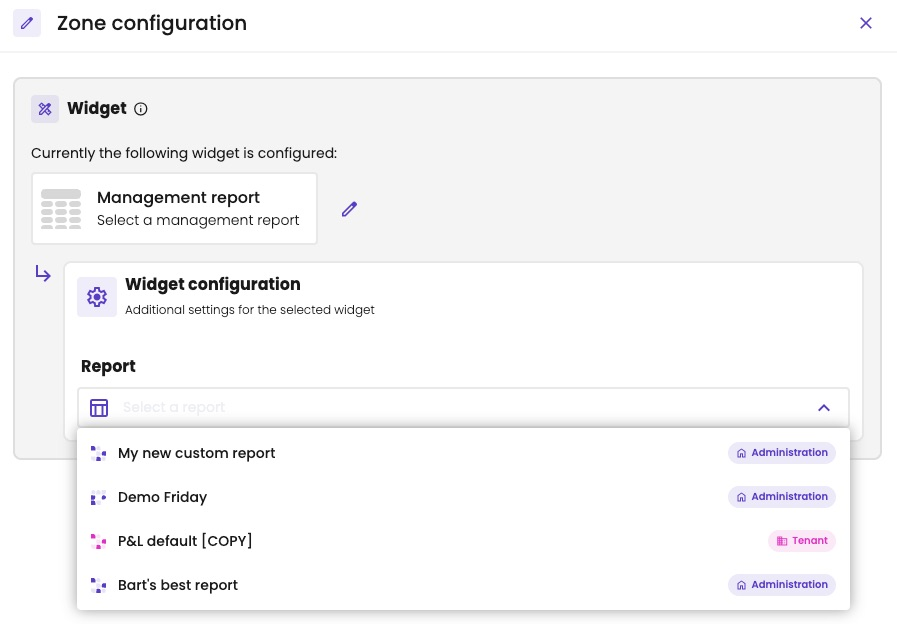
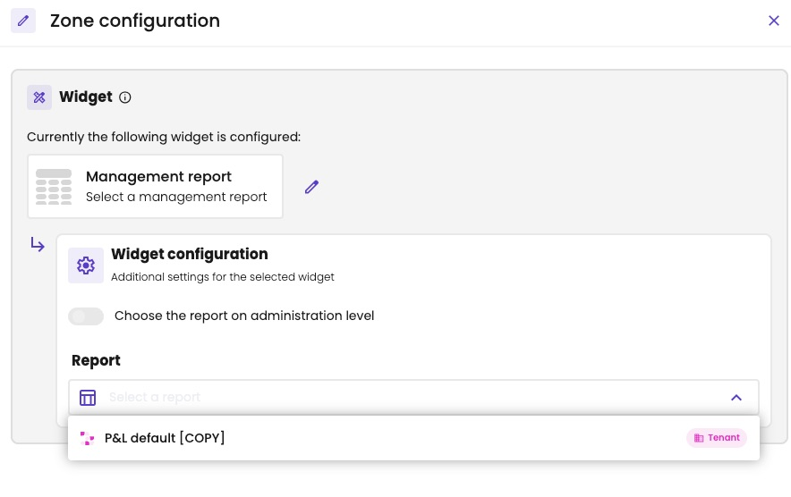
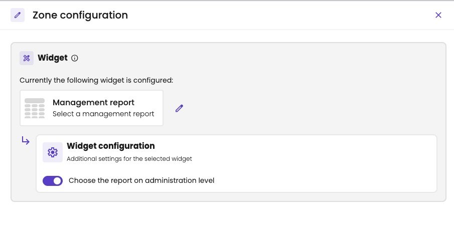
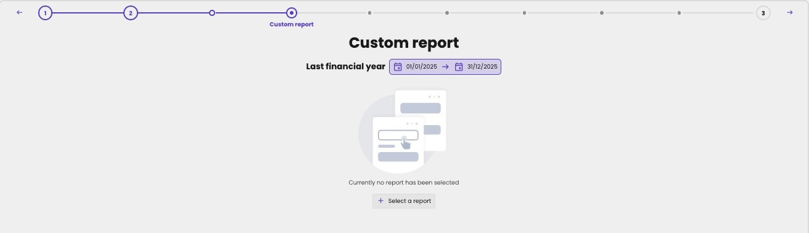
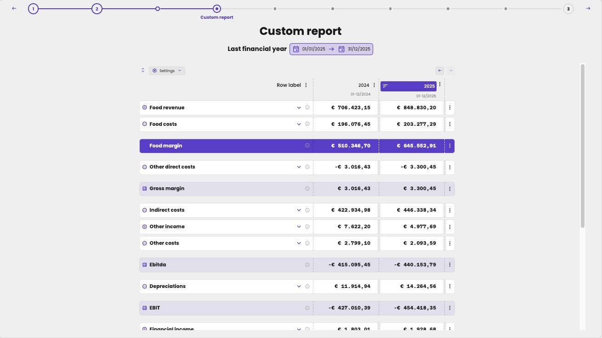

Shows a [management report](/guide/reports/management-reports/overview) of the administration, in the same way as the [P&L widget](/guide/meetings/widgets/pl) shows the profit and loss.

## Add the widget

1. Click a data zone of the slide. **Zone configuration** opens.
2. Under **Widget**, choose **Reports**.
3. Click **Management report**, and click **Apply**.
4. Under **Widget configuration**, choose the **Report**.

<Frame caption="Choose the management report to show.">
  
</Frame>

## Options

| Option | What it does |
|---|---|
| **Report** | Which management report the slide shows. The list holds the administration's own reports, marked **Administration**, and the library reports linked to it, marked **Tenant**. |

## In a meeting flow

A [meeting flow](/configure/meetings/meeting-flows) isn't tied to one administration. Under **Widget configuration**, you choose how the report is picked:

| **Choose the report on administration level** | What happens |
|---|---|
| On | The slide is a placeholder. In each meeting, the accountant chooses one of the administration's reports. |
| Off | Choose a **Report** from your firm's [library](/configure/reporting/management-report-library), marked **Tenant**. Every meeting from the flow shows it, also for administrations the report isn't linked to. |

<Frame caption="In a flow: choose a library report…">
  
</Frame>

<Frame caption="…or let the accountant choose the report in each meeting.">
  
</Frame>

With the placeholder, the slide in the meeting says *Currently no report has been selected*. Click **Select a report** to choose one.

<Frame caption="A placeholder slide in a meeting, before the accountant chooses the report.">
  
</Frame>

## Where it fits

A large zone, like the other report widgets. The slide's time period and reporting level decide which columns it shows.

<Frame caption="A management report on a slide, with the last two financial years.">
  
</Frame>
