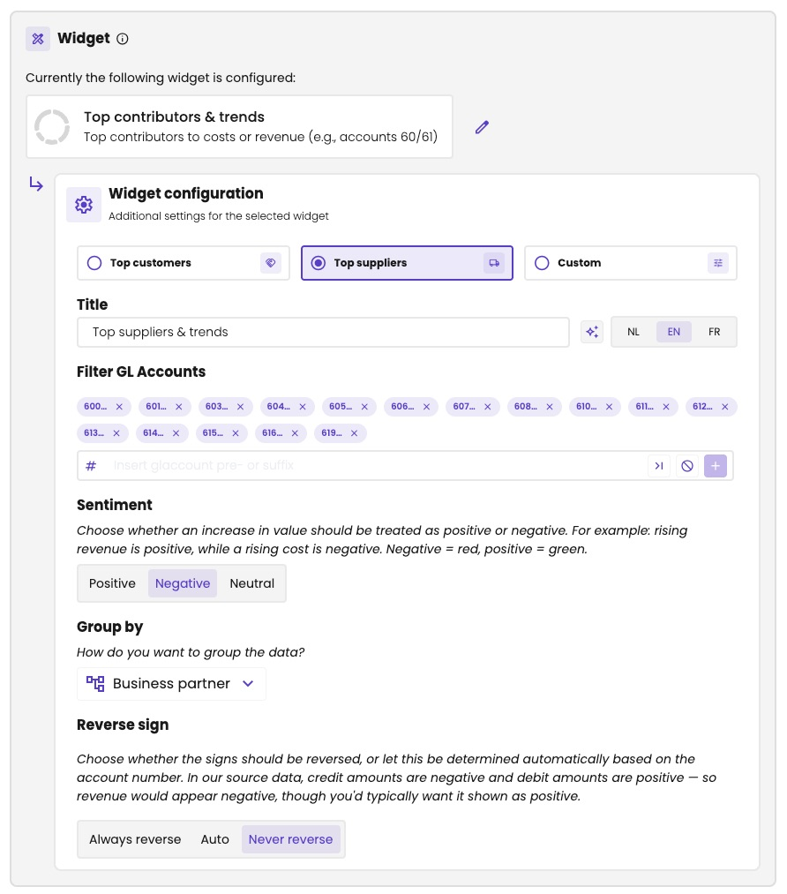
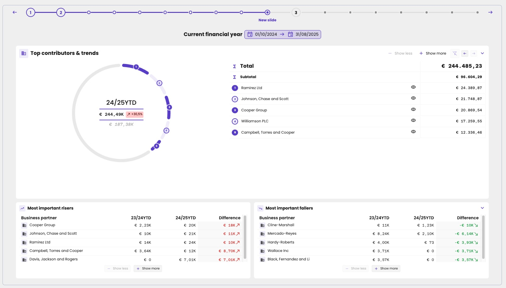
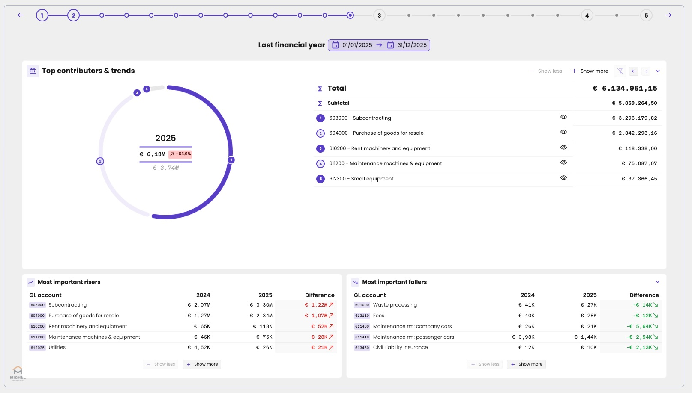

Shows which business partners, accounts or labels contribute most to a figure, and highlights the largest increases and decreases. For example: the top customers behind turnover, or the top suppliers behind costs, such as the purchases on accounts 60 and 61. It's a good way to talk about dependence on a few large customers or suppliers.

This widget needs transactions, so it only works for administrations from a bookkeeping connector. See [Bookkeeping and compliance connectors](/guide/dashboard/data-sync#bookkeeping-and-compliance-connectors).

## Options

Under **Widget configuration**, start with a quick select:

| Quick select | What it fills in |
|---|---|
| **Top customers** | The options for the largest customers behind turnover. |
| **Top suppliers** | The options for the largest suppliers behind costs: the title *Top suppliers & trends*, the accounts 600 to 619, **Sentiment** **Negative**, **Group by** **Business partner**, and **Never reverse**. |
| **Custom** | Nothing: you set the options yourself. |

{/* TODO Bart: which options does Top customers fill in (accounts 70?, Positive, Always reverse?)? Can you still change the options after a quick select, or only with Custom? */}

The options:

| Option | What it does |
|---|---|
| **Title** | The title of the widget, in **NL**, **EN** and **FR**. |
| **Filter GL Accounts** | The accounts to analyse. By default, the cost accounts. Type the first digits of an account number, for example *70* for all accounts starting with 70, and click **+**. The buttons in the field switch to *ends with* or turn a filter into *not*, as in a [line item](/guide/reports/management-reports/line-items#starts-with-ends-with-not). |
| **Sentiment** | Whether an increase is good news. **Positive** shows an increase in green, as for revenue. **Negative** shows it in red, as for costs. Or choose **Neutral**. |
| **Group by** | What to rank: **Business partner** (the default), GL account or label. |
| **Reverse sign** | **Always reverse**, **Auto** or **Never reverse**. See below. |

aiGust stores credit amounts as negative and debit amounts as positive, so revenue is negative in the source data. When you filter on revenue accounts, set **Sentiment** to **Positive** and reverse the sign, so revenue shows as a positive amount. With **Auto**, aiGust decides based on the account number.

The widget works on the transactions of the accounts you filter, added up per business partner, account or label.

<Frame caption="The quick select Top suppliers, with the options it fills in.">
  
</Frame>

## Where it fits

A medium or large zone.

<Frame caption="Top contributors & trends for costs, grouped by business partner.">
  
</Frame>

<Frame caption="The same widget, grouped by GL account.">
  
</Frame>
