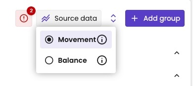
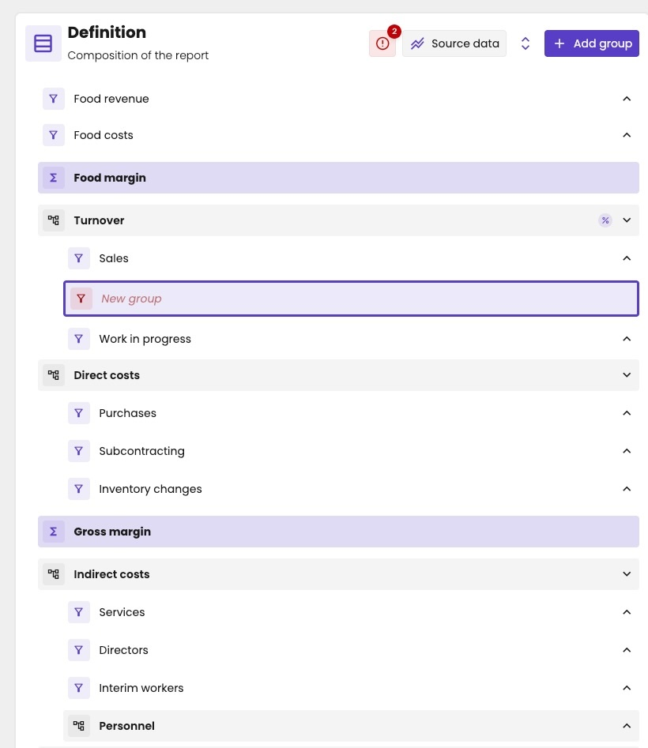

Open a [management report](/guide/reports/management-reports/overview) to see its two tabs:

- **Table:** the report with its figures, like a [standard report](/guide/reports/table/financial-table).
- **Definition:** the editor, where you build the rows of the report.

The editor shows the report without figures. Expand a group to see what's in it, down to the GL accounts. aiGust checks the definition against the administration's chart of accounts. See [Check the accounts](/guide/reports/management-reports/line-items#check-the-accounts).

<Frame caption="The definition of a management report, with the menu of the report open.">
  
</Frame>

## Source data

Click **Source data** to choose the figures the report works on. You choose one source for the whole report.

<Frame caption="Choose the source data of the report.">
  
</Frame>

| Source data | What it holds | Use it for |
|---|---|---|
| **Movement** | The movements per period, per GL account and business partner: the transactions of that period, added up. | Reports over a period, such as a profit and loss or a cash flow. Most management reports use this. |
| **Balance** | The balance per GL account and business partner at a point in time: all movements up to then, added up. | Reports at a date, such as a balance sheet. |

The source decides how aiGust fills a column that covers several periods, such as a financial year or year to date:

- **Movement:** aiGust adds up the periods in the column.
- **Balance:** aiGust takes the balance at the end of the column's last period.

Both sources work for every administration, also for one that only comes from a [compliance connector](/guide/concepts/financial-periods#compliance-connectors), such as Silverfin. Its figures have no business partners, though, and are often only available per financial year: then the report has no quarter or period view.

## Group types

Each group is one of three types:

| Type | Icon | What it holds |
|---|---|---|
| **Section** | Boxes | Other groups: sections, line items or formulas. Not individual GL accounts. See [Sections](/guide/reports/management-reports/sections). |
| **Formula** | Σ, highlighted | A calculation that adds or subtracts other groups. See [Formulas](/guide/reports/management-reports/formulas). |
| **Line item** | Funnel | GL accounts, selected with filters on the source data. See [Line items](/guide/reports/management-reports/line-items). |

## Add a group

A new group is added at the level of the group you selected:

1. Click a group at the level where you want the new group.
2. Click **Add group**.
3. Under **Group settings**, choose the type: **Section**, **Formula** or **Line item**.
4. Enter the **Name**, in each language: **NL**, **EN** and **FR**.

So to add a group at the top level, first click a group at the top level. To add a group in a section, click a group inside that section. To add the first group to a new, empty section, see [Sections](/guide/reports/management-reports/sections#add-groups-to-a-section).

<Frame caption="A new line item inside the Turnover section, between Sales and Work in progress.">
  
</Frame>

Drag and drop groups to move them, also to another level. When a move isn't allowed, a message appears and the group stays where it was. For example, you can't move a top-level group into a section while a [formula](/guide/reports/management-reports/formulas) still uses it: formulas only use top-level groups.

You can also drag accounts from one line item to another. See [Move an account to another line item](/guide/reports/management-reports/line-items#move-an-account-to-another-line-item).

A group without a name shows in red. The icon next to **Source data** counts what still needs your attention:

- **Red:** errors, such as a group without a name in **NL**, **EN** or **FR**. You can't save the report until you fix them.
- **Orange:** warnings, such as accounts used in more than one line item. You can still save.

## Group settings

Click a group to open its **Group settings**:

| Setting | What it does |
|---|---|
| **Section**, **Formula**, **Line item** | The type of the group. |
| **Name** | The name in the report, in each language. |
| **Operator** | Plus or minus: whether a [formula](/guide/reports/management-reports/formulas) adds or subtracts this group. Only for top-level groups. |
| **Use as vertical reference value** | Makes this group the [vertical reference](#vertical-reference). |
| **Show this row in a distinct colour in the report** | Highlights the row in the report, for example a subtotal. |
| **Open this section automatically** | Shows the section expanded when you open the report. |

To remove a group, click **Delete group**.

### Change the type of a group

You can change the type of an existing group, but you lose what it holds:

- **From a section** to a formula or a line item: all its subgroups are deleted.
- **From a line item** to a section or a formula: all its filters are removed.

<Warning>
aiGust warns you before it changes the type, but take care: the subgroups or filters are gone. If it was a mistake, click the undo arrow to step back.
</Warning>

## Vertical reference

Each report has one vertical reference: the line that aiGust calculates all percentages against. In a profit and loss, that's usually the turnover.

Turn on **Use as vertical reference value** in the settings of that group. A % icon marks it in the definition.

## Check the accounts

The bar under the group settings shows whether every GL account is in exactly one line item: in green when it is, in red for unused accounts, and in orange for accounts used more than once. Click it to see which accounts. See [Check the accounts](/guide/reports/management-reports/line-items#check-the-accounts).

## Save your changes

Your changes aren't saved automatically. Use the arrows to undo or redo a change, and click **Save** to keep them.

You can't save while the definition has errors, such as a group without a name in every language. See [Add a group](#add-a-group).
