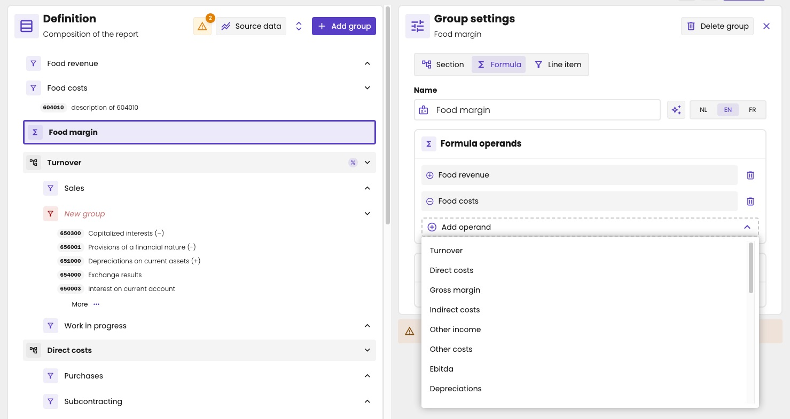

A formula is the group in a [management report](/guide/reports/management-reports/overview) that calculates a line from other groups. It adds or subtracts them. For example, *Gross margin* = *Turnover* – *Direct costs*.

A formula shows with a Σ icon in the definition, and is highlighted.

## Add a formula

1. Click a group at the top level, and click **Add group**.
2. Under **Group settings**, choose **Formula**.
3. Enter the **Name**, in each language: **NL**, **EN** and **FR**.
4. Under **Formula operands**, click **Add operand**, and choose a group.
5. Repeat for each group in the formula. To remove one, click the bin next to it.

A formula can only be at the top level of the report, and can only use top-level groups: the groups at the first level of the report. That includes other formulas: *EBIT* can start from *Gross margin*, for example.

<Frame caption="Food margin adds Food revenue and subtracts Food costs.">
  
</Frame>

## Add or subtract

You don't choose in the formula whether a group is added or subtracted. That comes from the **Operator** in the settings of the group itself: plus is added, minus is subtracted. So to subtract *Direct costs*, set its operator to minus. The operator then applies in every formula that uses the group.

On the **Table** tab, the plus or minus in front of each row shows its operator. The [vertical reference](/guide/reports/management-reports/editor#vertical-reference) shows an empty circle instead.

<Frame caption="The formula Food margin in the report: Food revenue minus Food costs, shown in a distinct colour.">
  
</Frame>

The operator doesn't change how the group itself shows in the report. For that, line items have **Reverse sign**. See [Reverse the sign](/guide/reports/management-reports/line-items#reverse-the-sign).

## Settings of a formula

Like other top-level groups, a formula has the settings **Use as vertical reference value**, **Show this row in a distinct colour in the report** and **Open this section automatically**. See [Group settings](/guide/reports/management-reports/editor#group-settings).
