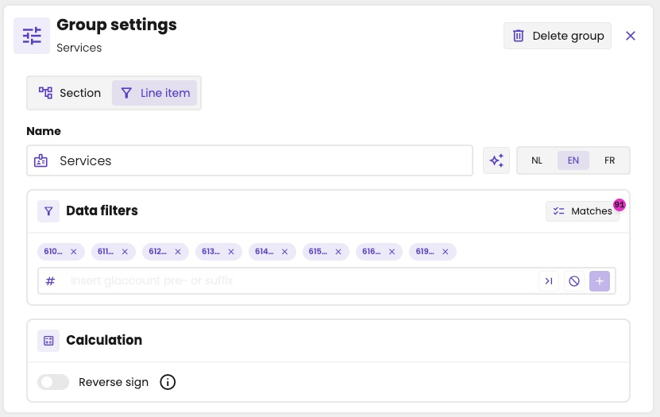
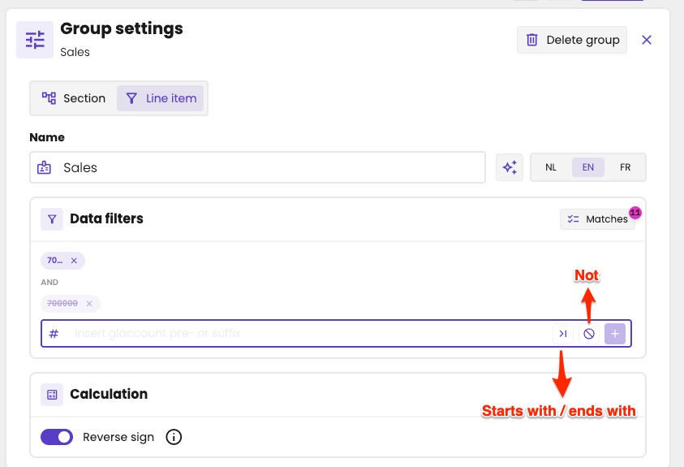
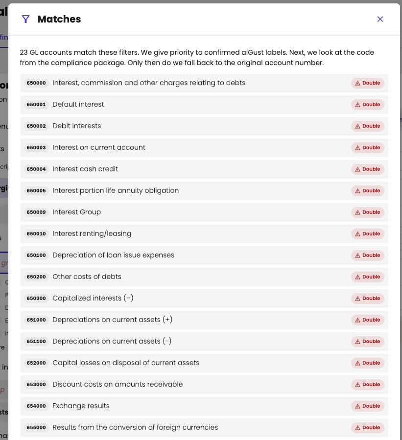
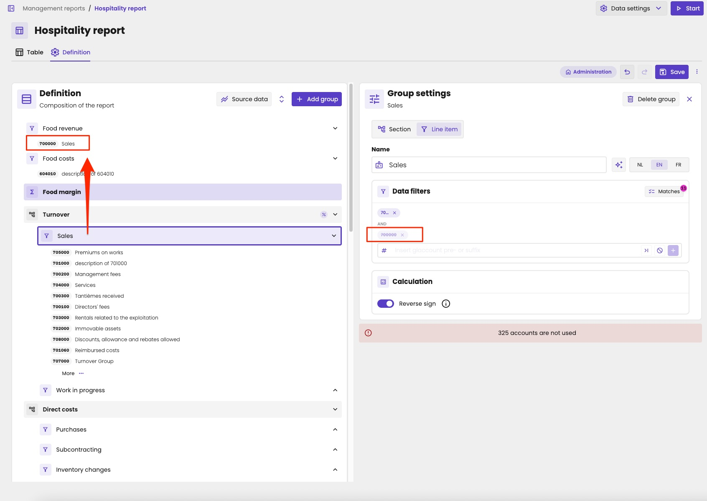
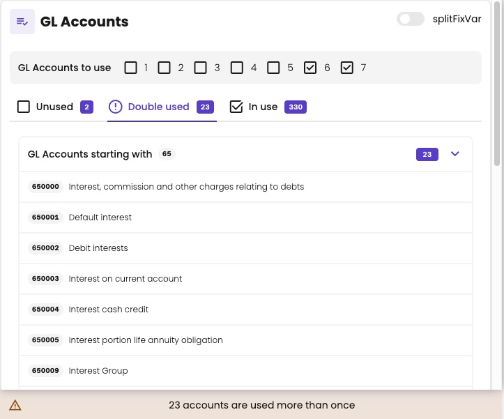
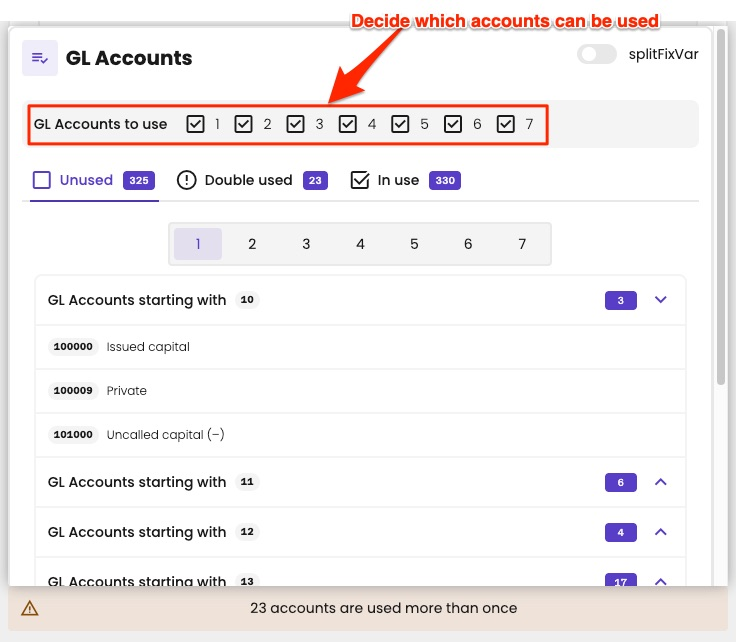
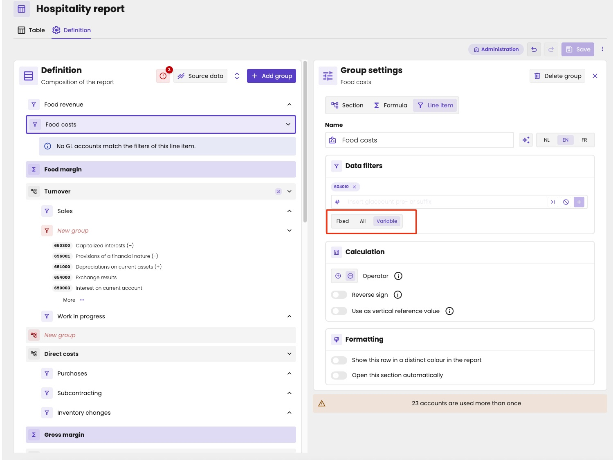

A line item is the group in a [management report](/guide/reports/management-reports/overview) that holds GL accounts. It filters the source data: only the accounts that match its filters count towards it. At the lowest level, every report comes down to line items.

Today you filter on the GL account code.

<Frame caption="The settings of a line item that holds the accounts starting with 610 to 616 and 619.">
  
</Frame>

## Add a filter

1. Click the line item, so its **Group settings** open.
2. Under **Data filters**, enter the first digits of the accounts in **Insert glaccount pre- or suffix**, for example *70*.
3. Click **+** to add the filter.

Add a filter for each range you need. Turnover, for example, holds the accounts that start with 70 or 71: add *70* and *71*. An account matches when it meets any of them.

To remove a filter, click the **×** on it.

### Starts with, ends with, not

By default, a filter selects the accounts that start with the digits you enter. Two buttons in the field change that, before you click **+**:

| Button | What it does |
|---|---|
| **>\|** | Switches between *starts with* and *ends with*. |
| **⊘** (not) | Turns the filter around: the line item leaves out the accounts that match. A "not" filter shows struck through. |

<Frame caption="The buttons for ends with and not, next to the field.">
  
</Frame>

aiGust combines the filters like this:

- The filters that select accounts add up: an account matches when it meets **any** of them.
- The "not" filters add up too: an account is left out when it meets **any** of them.
- The two sets are combined with **AND**: an account must match a filter, and none of the "not" filters.

Say you want to show accounts 700001 and 700002 in a line item of their own:

- The new line item filters on *starts with 700001* and *700002*.
- The turnover line item filters on *starts with 70* and *71*, and *not 700001* and *not 700002*.

### Check which accounts match

The badge on **Matches** shows how many GL accounts match the filters. Click **Matches** to see them. **Double** marks an account that's also in another line item.

<Frame caption="The accounts that match the filters of a line item.">
  
</Frame>

When no account matches, the definition shows *No GL accounts match the filters of this line item.*

## Which code aiGust filters on

aiGust filters on the account code, but not always the one from the bookkeeping. For each account, it uses the first code available, in the same order as for the [standard reports](/guide/concepts/labels#how-labels-affect-your-reports):

1. **The code of the confirmed label,** once you've confirmed or changed the [label](/guide/concepts/label-mapping) of the account in aiGust.
2. **The compliance code:** the code from a [compliance connector](/guide/concepts/financial-periods#compliance-connectors), such as the headings in the Adsolut fiscal files or the Silverfin mapping.
3. **The account number from the bookkeeping.** Most accounts use this one.

So if you remapped an account from 61 to 60 in aiGust, Adsolut or Silverfin, a filter on *60* selects it, and a filter on *61* doesn't. Hover over the code of an account in the definition to see which code aiGust used.

## Move an account to another line item

You can also drag an account from one line item to another:

1. Expand the line item, so you see its accounts.
2. Drag the account. Only the line items where you can drop it light up.
3. Drop it on the other line item.

aiGust adds the filters for you: a "not" filter on the account in the line item it came from, and a filter on the account in the line item you dropped it on.

<Frame caption="Account 700000 moved from Sales to Food revenue: Sales now leaves it out.">
  
</Frame>

You can only drop an account on a line item: sections and formulas don't hold accounts.

## Check the accounts

The bar under the group settings shows whether every GL account of the administration is in the report exactly once:

- **All accounts are used once,** in green: every account is in exactly one line item.
- **325 accounts are not used,** in red, for example: those accounts aren't in any line item, so the report leaves them out.
- **23 accounts are used more than once,** in orange, for example: those accounts count in more than one line item.

The check is there to help you. Click the bar to open **GL Accounts**, with three tabs:

| Tab | Shows the accounts that are |
|---|---|
| **Unused** | In no line item. That can be normal: a profit and loss doesn't use the balance sheet accounts. |
| **Double used** | In more than one line item. You normally don't want that. |
| **In use** | In exactly one line item. |

The accounts are grouped by their first digits. To move an account, drag it in the definition: you can't drag from the check. See [Move an account to another line item](#move-an-account-to-another-line-item).

<Frame caption="The accounts used in more than one line item.">
  
</Frame>

### Leave out account classes

Under **GL Accounts to use**, clear the account classes the report doesn't need, such as 1 to 5 for a profit and loss. The check then leaves those accounts out.

<Frame caption="Choose which account classes the check takes into account.">
  
</Frame>

<Note>
Your choice of account classes is only saved in your browser. Your colleagues, or you in another browser, still see all classes.
</Note>

The check only warns you: you can save a report with unused accounts, or with accounts used more than once.

## Reverse the sign

aiGust doesn't keep debit and credit apart. Every amount has a sign: debit is positive, credit is negative. Revenue accounts are credit accounts, so their amounts are normally negative. Cost accounts normally have positive amounts.

Turn on **Reverse sign** under **Calculation** to turn the sign of the line item around. Do this for revenue, for example, so it shows as a positive amount instead of a negative one. Only line items have this setting.

Reverse sign and the **Operator** do different things:

- **Reverse sign** decides how the line item shows: as a positive or a negative amount.
- **Operator** decides whether a [formula](/guide/reports/management-reports/formulas) adds or subtracts the group.

So to show both turnover and direct costs as positive amounts, and still calculate *Gross margin* = *Turnover* – *Direct costs*, give *Direct costs* the operator minus.

## Split fixed and variable costs

A line item can also filter on whether an account is fixed or variable. You build, for example, a line item *Fixed rental costs* and a line item *Variable rental costs*. This is advanced: most reports don't need it.

1. Click the bar at the bottom of the group settings, to open the [account check](#check-the-accounts).
2. Turn on **Split fix/var**. aiGust then takes the fixed/variable split of the accounts into account. {/* The switch still reads splitFixVar on screen; Bart: it will be renamed to Split fix/var. */}
3. Under **Data filters** of the line item, choose **Fixed**, **Variable** or **All**.

<Frame caption="A line item that only holds the variable part of its accounts.">
  
</Frame>

aiGust uses the fixed/variable split you set on the administration's accounts. See [Contribution margin](/guide/reports/definitions/profit-and-loss#contribution-margin).

<Note>
For now, **Split fix/var** is only saved in your browser. Your colleagues, or you in another browser, have to turn it on again.
</Note>
