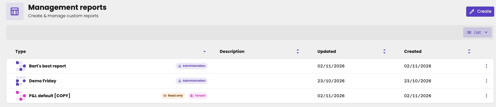
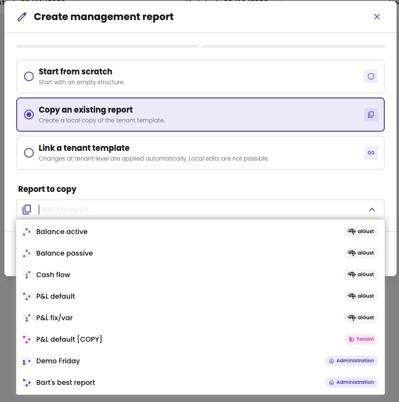
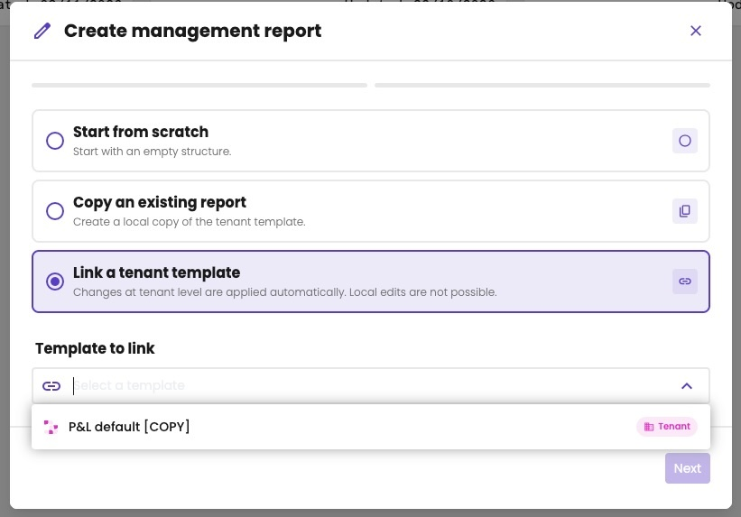
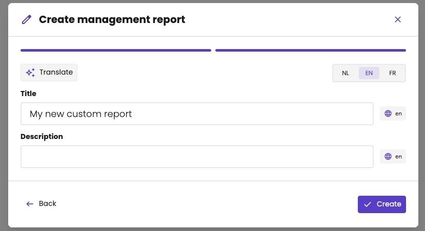
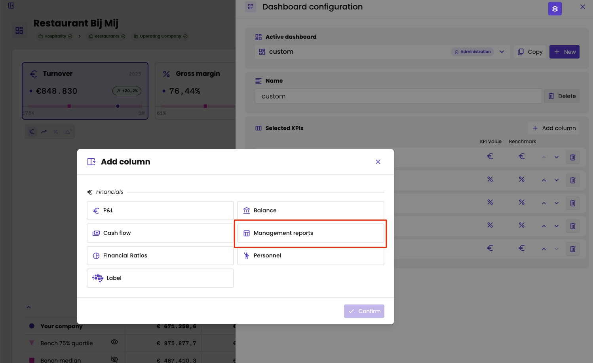
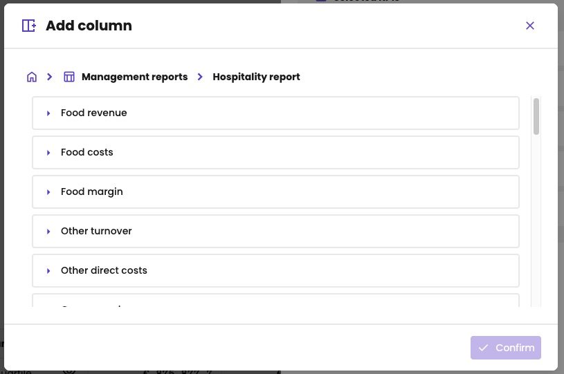
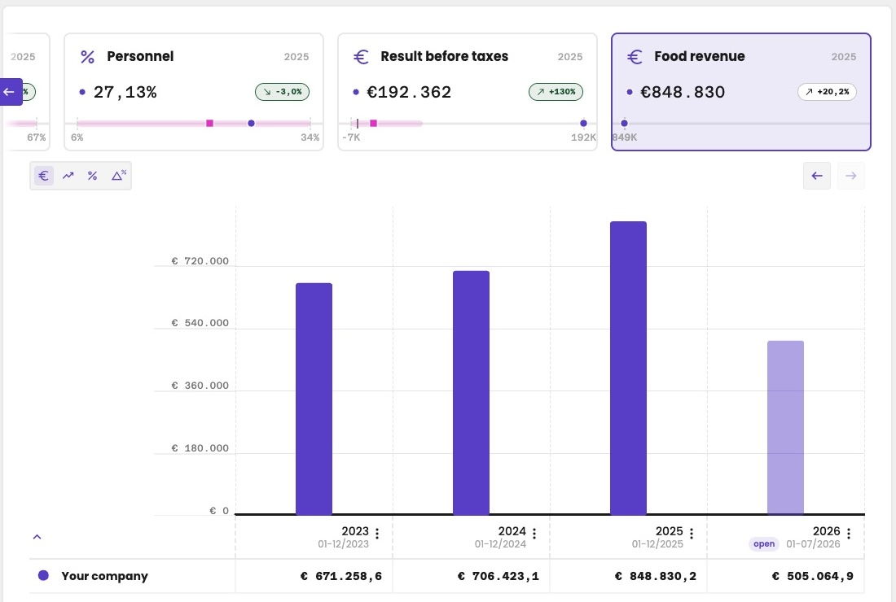
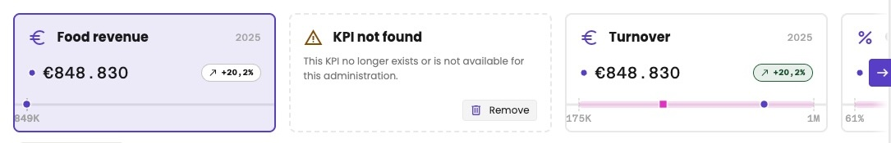

The [standard reports](/guide/reports/overview), such as the profit and loss and the balance sheet, are the same for every administration. With management reports, you build your own. You decide how the accounts are grouped, how the lines add up, and which results aiGust calculates.

A typical example: a profit and loss for a restaurant that shows food and beverages separately, each with its own costs and its own margin.

Click **Management reports** under **Financials** in the administration menu. An administration can have as many management reports as you like. They live next to the standard reports, and don't change them.

The list shows each report with its source:

- **Administration:** a report of this administration only.
- **Tenant**, with **Read only:** a report from your firm's library, linked to this administration. See [Use a report from the library](#use-a-report-from-the-library).

<Frame caption="The management reports of an administration.">
  
</Frame>

## How a report is built

A management report is a set of rows, organised in groups. Each group is one of three types:

| Type | What it does | Example |
|---|---|---|
| **Section** | Holds other groups. See [Sections](/guide/reports/management-reports/sections). | *Turnover*, holding *Sales* and *Work in progress*. |
| **Line item** | Pulls in GL accounts, with filters on the source data. See [Line items](/guide/reports/management-reports/line-items). | All accounts starting with 70 or 71. |
| **Formula** | Adds or subtracts other groups. See [Formulas](/guide/reports/management-reports/formulas). | *Gross margin* = *Turnover* – *Direct costs*. |

At the lowest level, every report comes down to GL accounts, selected by line items.

The report only defines the rows. The columns, such as the financial year or year to date, depend on the view you choose, as in the standard reports. See [Financial table](/guide/reports/table/financial-table).

You build the rows in the [editor](/guide/reports/management-reports/editor).

## Create a management report

1. Click **Create**.
2. Choose how to start:
   - **Start from scratch:** an empty report, that you build yourself.
   - **Copy an existing report:** under **Report to copy**, choose any report: an aiGust standard report, such as **P&L default** or **Balance active**, a report from your firm's library (**Tenant**), or a report of an administration. You then change the copy as you like.
   - **Link a tenant template:** under **Template to link**, choose a report from your firm's library. You can't change it here. See [Use a report from the library](#use-a-report-from-the-library).
3. Click **Next**.
4. Enter a **Title**, and optionally a **Description**, in each language: **NL**, **EN** and **FR**. Click **Translate** to translate them into the other languages automatically.
5. Click **Create**.

<Frame caption="Copy an existing report: from aiGust, from your firm's library or from an administration.">
  
</Frame>

<Frame caption="Link a tenant template: only the reports of your firm's library.">
  
</Frame>

<Frame caption="Step 2: the title and the description, in each language.">
  
</Frame>

A linked report also gets its own title in the administration. Use the library title, so you recognise the report later.

Then build the report in the [editor](/guide/reports/management-reports/editor).

Everyone who can edit the administration can create, change and delete its management reports.

## Use a report from the library

Your firm can keep a library of management reports, so you don't build the same report for every administration. See [Management report library](/configure/reporting/management-report-library). When you [create a report](#create-a-management-report) from a library report, you choose how: **Copy an existing report** or **Link a tenant template**.

| | **Copy** | **Link** |
|---|---|---|
| What you get | A copy of the report in this administration. | The library report itself, assigned to this administration. |
| Can you change it here? | Yes, freely. | No. Only key users change it, in the library. |
| When the library report changes | Your copy stays as it is. | The change applies to this administration too. |
| When the library report is deleted | Your copy stays. | The report disappears from this administration. |

Choose **Link** for a report that must look the same everywhere. Choose **Copy** when one administration needs its own variant.

## Use a management report in a meeting

1. In the meeting editor, add the [Management report widget](/guide/meetings/widgets/management-report) to a slide.
2. Choose the report.

The list only shows the reports of this administration: its own reports, and the library reports linked to it.

A meeting flow can also show a library report on a slide, or leave the choice to you in each meeting. See [In a meeting flow](/guide/meetings/widgets/management-report#in-a-meeting-flow).

## Use a line as a KPI on the dashboard

Any line of a management report can be a KPI card on the [dashboard](/guide/dashboard/dashboard).

1. On the administration's **Overview**, click **Edit KPI dashboard**. See [Customise the dashboard](/guide/dashboard/dashboard#customise-the-dashboard-of-one-administration).
2. Under **Selected KPIs**, click **Add column**.
3. Under **Financials**, choose **Management reports**.
4. Choose a report, and browse it like a profit and loss: click the arrow in front of a group to open it.
5. Choose the line, and click **Confirm**.

<Frame caption="Under Financials, choose Management reports.">
  
</Frame>

<Frame caption="Choose a line of the report.">
  
</Frame>

Management reports are your own reports, so there are no benchmarks for them. The card shows the value and its growth, but no benchmark.

<Frame caption="Food revenue from the Hospitality report as a KPI card, without a benchmark, next to standard KPIs.">
  
</Frame>

You can only choose a report of this administration: one created for it, or a [library report](/configure/reporting/management-report-library) linked to it. So you add these KPIs on the dashboard of one administration, not in a [firm-wide template](/configure/reporting/kpi-dashboard-templates).

When a KPI can no longer be found, for example because you deleted its report, the dashboard shows **KPI not found** instead of the card. aiGust never removes these cards itself: click **Remove** to take the KPI off the dashboard.

<Frame caption="The KPI of a deleted report.">
  
</Frame>

You can't use management report lines in [triggers](/guide/triggers/how-triggers-work) or [benchmarks](/guide/benchmarking/how-it-works) yet.

## Rename, download or delete a report

Open the report, and click the three dots at the top right:

- **Rename:** change the title.
- **Download definition:** download the definition of the report as a JSON file. Exporting to PDF or Excel isn't available yet.
- **Delete:** delete the report.
