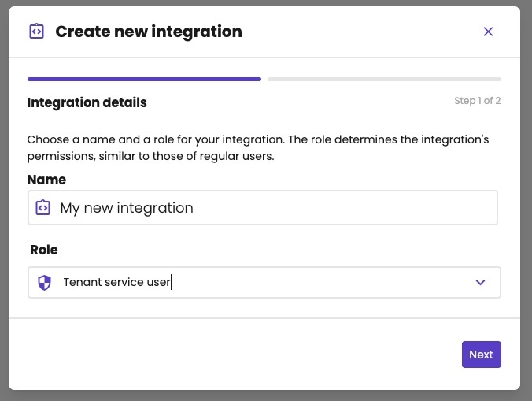
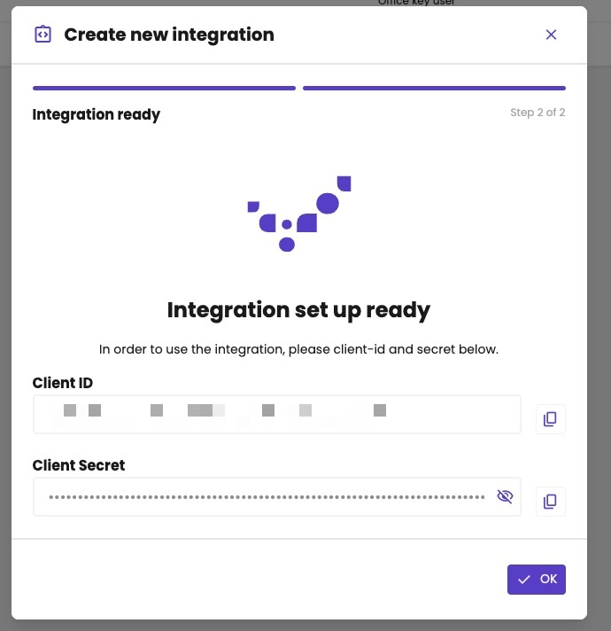
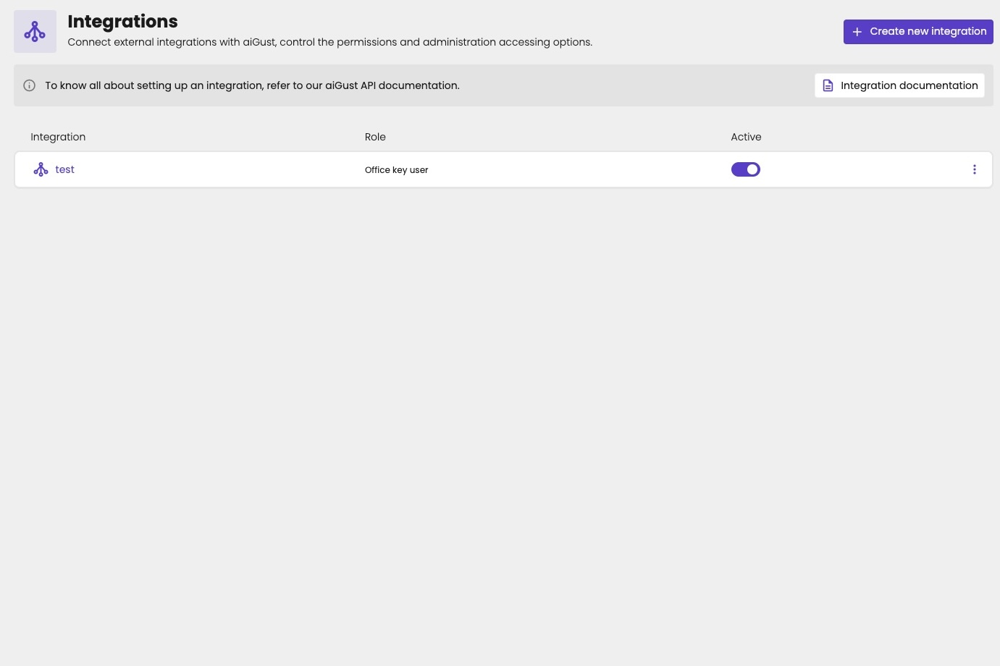
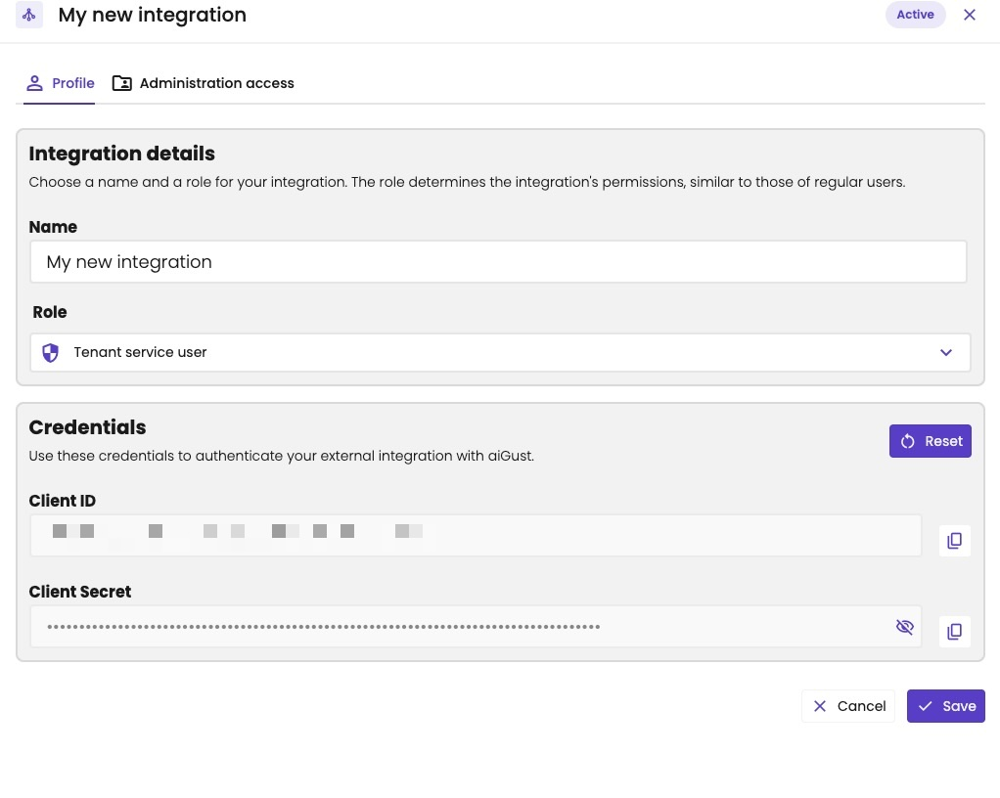
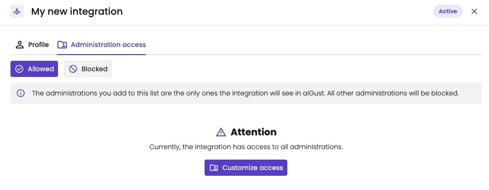

Every call to the aiGust API needs an access token. You get one with the client ID and secret of a **service user**: a user in aiGust that belongs to your integration, not to a person.

We use OAuth 2.0, but only the **client credentials** grant. There's no authorization code flow: no user signs in, no consent screen, no redirect URL. Your software exchanges the client ID and secret for a token directly.

## Get a client ID and secret

How you get the credentials depends on the integration:

| Integration | Where the credentials come from |
|---|---|
| **Use the API**, for example to read data or to create users | A key user creates an integration in the aiGust portal. See [Create an integration](#create-an-integration). |
| **[External data uploads](/integrate/ext-upload-overview)** | aiGust creates the service user and its credentials automatically with your upload connector. |

Either way, the token works the same. See [Request an access token](#request-an-access-token).

### Create an integration

A key user of the firm creates the integration:

1. Click **Settings** in the main rail, and choose **Integrations**.
2. Click **Create new integration**.
3. Enter a **Name**, and choose a **Role**. The role decides what the integration may do. See [What the service user may do](#what-the-service-user-may-do).
4. Click **Next**.
5. Copy the **Client ID** and the **Client Secret** with the copy buttons, and click **OK**.

<Frame caption="Step 1: a name and a role.">
  
</Frame>

<Frame caption="Step 2: the client ID and secret of the new integration.">
  
</Frame>

You can choose any role of the firm: **Office key user**, **Standard office user** or **Tenant service user**. Choose the lowest role that allows what your integration does. For example, managing client users needs **Office key user**. See [Roles](/setup/users/roles).

### Manage an integration

The integrations list shows each integration with its role, and an **Active** switch. Turn it off to block the integration.

<Frame caption="The integrations of a firm.">
  
</Frame>

Click an integration to open it. It has two tabs:

- **Profile:** change the **Name** and the **Role**, and click **Save**. Under **Credentials**, you can copy the **Client ID** and the **Client Secret** again. Click **Reset** to rotate the secret, for example when it leaked. The client ID stays the same. Then update the secret in your software.
- **Administration access:** by default, the integration has access to all administrations. Click **Customize access** to choose the ones it may see (**Allowed**) or may not see (**Blocked**). This works as for a user. See [Restrict administration access](/setup/users/restrict-access).

<Frame caption="The Profile tab: the name, the role and the credentials of an integration.">
  
</Frame>

<Frame caption="The Administration access tab: by default, the integration sees all administrations.">
  
</Frame>

## Request an access token

Post the client ID and secret to the token URL of the environment, as `x-www-form-urlencoded`:

| Environment | Token URL |
|---|---|
| Production | `https://auth.prod.ai-gust.io/realms/aigust-app/protocol/openid-connect/token` |
| Development | `https://auth.dev.ai-gust.io/realms/aigust-app/protocol/openid-connect/token` |

Each environment has its own integrations and credentials: a client ID from production doesn't work on development.

```bash
curl -X POST "https://auth.prod.ai-gust.io/realms/aigust-app/protocol/openid-connect/token" \
  -H "Content-Type: application/x-www-form-urlencoded" \
  -d "grant_type=client_credentials" \
  -d "client_id={YOUR_CLIENT_ID}" \
  -d "client_secret={YOUR_CLIENT_SECRET}"
```

Response:

```json
{
  "access_token": "eyJhbGciOi...",
  "expires_in": 300,
  "refresh_expires_in": 0,
  "token_type": "Bearer",
  "scope": "aigust-frontend-claims"
}
```

Send the token as a bearer token with every API call:

```bash
curl "https://api.prod.ai-gust.io/api/v01/tenants/{TENANT_ID}/administrations" \
  -H "Authorization: Bearer {ACCESS_TOKEN}"
```

## When the token expires

A token is valid for 5 minutes (`expires_in`, in seconds). There's no refresh token: `refresh_expires_in` is `0`. When the token expires, request a new one with the client ID and secret, in the same way.

Cache the token and reuse it until it expires. When a call returns `401 Unauthorized`, request a new token and retry the call.

## What the service user may do

The service user's role decides what it may do, exactly as for a person with that role. A call outside its permissions returns `403 Forbidden`. The service user also only sees the administrations it has access to.

| Response | Meaning | What to do |
|---|---|---|
| `401 Unauthorized` | The token is missing, invalid or expired. | Request a new token. |
| `403 Forbidden` | The token is valid, but the service user may not make this call. | Check the role and the administration access of the integration. |

Credentials of an upload connector are scoped to that connector. See [External data uploads](/integrate/ext-upload-overview#what-you-need-to-start).

## Keep the credentials safe

- Store the client secret like a password, on your server. Never put it in a browser app or a mobile app.
- Give the integration the lowest role it needs, and only the administrations it needs.
- Turn off **Active** for an integration you no longer use.
