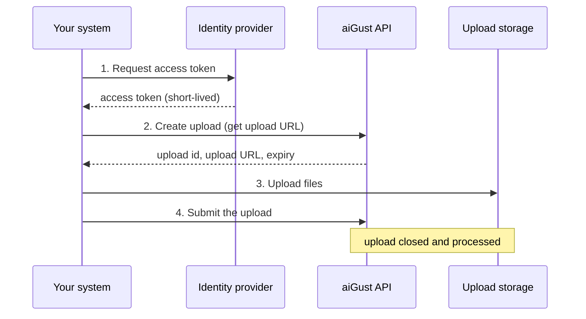

<Note>
Partner uploads are a bespoke integration, not a self-serve feature. The data format of the files you upload is agreed with aiGust up front. Contact us at [integrations@ai-gust.io](mailto:integrations@ai-gust.io) before you start: once we have aligned on the format, we provide a custom connector for you in the aiGust portal and **test credentials** to try the flow before going live.
</Note>

Some aiGust connectors don't pull data out of your software. Instead, you — the integration partner — upload data files to aiGust yourself, through a small API and a secure upload location in an agreed upon format.

You never receive storage credentials or account keys. All storage access happens through a strictly scoped, time-limited **upload URL** that our API generates for you.

## The lifecycle

1. You request an access token with your client credentials.
2. You create an upload. aiGust answers with an upload URL: a write-only location in Azure Data Lake Storage, valid for 2 days.
3. You upload your files to that URL.
4. You submit the upload. aiGust closes it (the URL stops working immediately) and processes your files.

Depending on the agreed setup, open uploads may also be processed automatically on a daily schedule. You can always submit manually as well.

## Concepts

- **Upload.** Your files are grouped in an *upload batch*. Submitting the upload closes it and sends the files for processing.
- **Scopes.** An upload covers either your whole connector (all administrations) or a single administration (when you pass `administration_code`). Multiple administrations can have an open upload at the same time, but only one open upload per scope.
- **Full upload.** Pass `full_upload=true` when creating the upload to send *all* data from scratch instead of only the changes since last time.

## What you need to start

Partner uploads start with a conversation: contact us at [integrations@ai-gust.io](mailto:integrations@ai-gust.io) to align on the data format of your files. Once that is settled, we provide a custom connector for you in the aiGust portal and a set of **test credentials**, so you can try the full flow before going live.

The credentials are provisioned automatically with the connector. You receive:

| What | Used for |
|---|---|
| **Client ID** + **Client Secret** | Requesting access tokens |
| **Tenant ID** | Identifies the firm in API calls |
| **Connector ID** | Identifies your upload connection in API calls |
| **API base URL** + **token URL** | The exact endpoints to call |

The connector page in the portal shows all of this as one copyable JSON document.

Your credentials are scoped to your own connector. Calls for any other connector — even of the same firm — are rejected with `403 Forbidden`.

Ready? Continue to the [API walkthrough](/integrate/upload-api).
