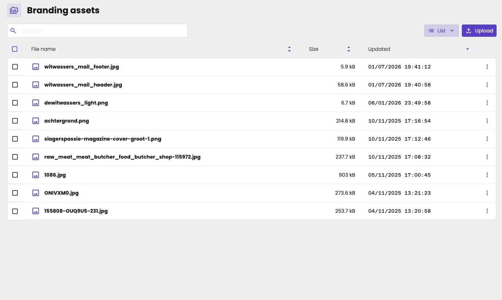

Branding assets are your firm's own cloud drive for branding: logos, background images, the header and footer of your emails, or the title page of a PDF report. Upload them once, and pick them wherever aiGust asks for an image, for example as the background of a meeting's intro slide.

Click **Settings** in the main rail, and choose **Branding assets**.

<Note>
Only key users can manage your firm's branding.
</Note>

<Frame caption="Your firm's branding assets.">
  
</Frame>

## Upload a branding asset

1. Click **Upload**.
2. Select a file, or drag and drop it. You can upload PNG, JPG and WebP files.
3. Click **Next**.

Click the three dots on a file to **Download** or **Delete** it.

<Warning>
Branding assets are publicly available, for example so that email programs can show your header. Store confidential documents in the [cloud drive](/guide/documents/cloud-drive) of the administration instead.
</Warning>

## Where you use them

- **Meetings:** as the background image of the intro slide. See [A background image](/guide/meetings/customize#a-background-image).
- **Emails:** as the header and footer. See [Mail layout](/setup/branding/mail-settings).
- **PDF reports:** for example as the title page, once PDF reports are back. See [PDF reports](/guide/documents/pdf-reports).

## Firm and administration branding

Each administration also has branding files of its own, such as its logo.

| | Your firm | An administration |
|---|---|---|
| **What for** | Your firm's assets, used for all clients | One client's assets, such as its logo |
| **Where** | **Settings** › **Branding assets** in the main rail | **Settings** › **Branding** in the administration menu. See [Branding files](/guide/dashboard/administration-properties#branding-files). |
