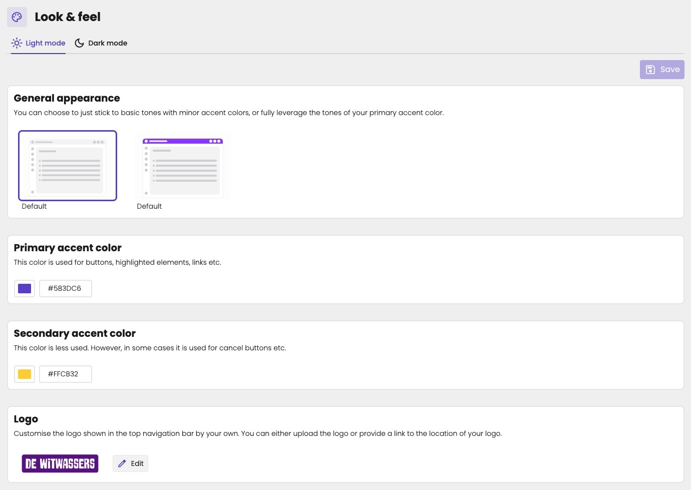

Give aiGust the look of your firm. Click **Settings** in the main rail, choose **Look & feel**, and open the **Light mode** tab. The **Dark mode** tab has the same settings, for users who work in dark mode.

Change what you need, and click **Save** at the top right.

The client portal uses the same colours and logo.

<Note>
Only key users can manage your firm's branding.
</Note>

<Frame caption="The colours and logo of your firm, in light mode.">
  
</Frame>

## General appearance

Choose how much colour aiGust uses:

- **The first option:** basic tones, with a touch of your accent colour. The top bar is neutral.
- **The second option:** the top bar in your primary accent colour.

{/* TODO Bart: in the new layout, do these options still change the top bar, or the main rail? Retake light-mode.jpg. */}

## Primary accent color

Used for buttons, highlighted elements, links and more. It's also the default background of the intro slide of a meeting. See [The background](/guide/meetings/customize#the-background).

Choose one of the **Standard colors**, or click **Choose** under **Custom color** to pick any colour.

## Secondary accent color

Used less often, for example for cancel buttons.

## Logo

The logo in the top navigation bar. Click **Edit** to upload your logo, or to give a link to where your logo is stored.

Set a logo for each mode. A logo with dark text disappears on a dark background, so use a light version on the **Dark mode** tab.
