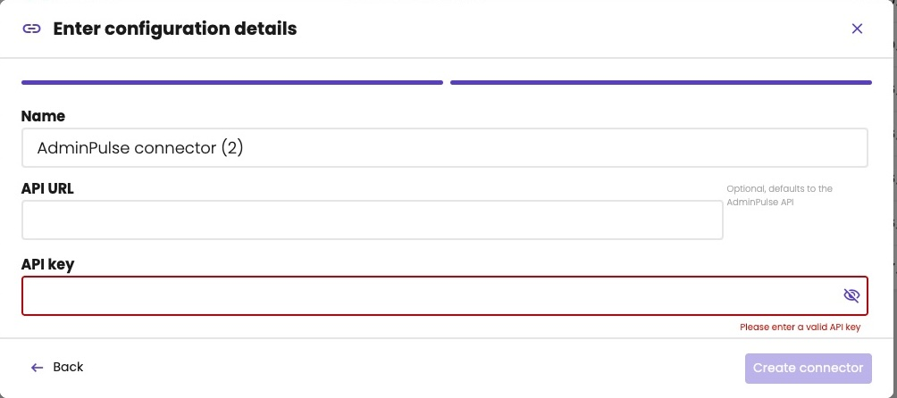
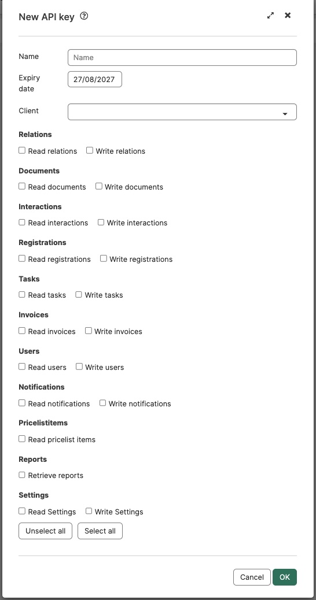
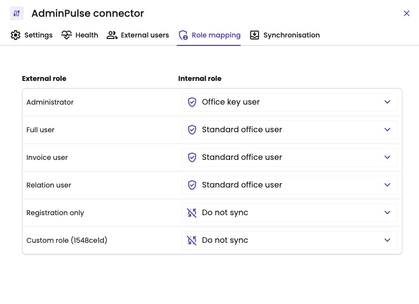
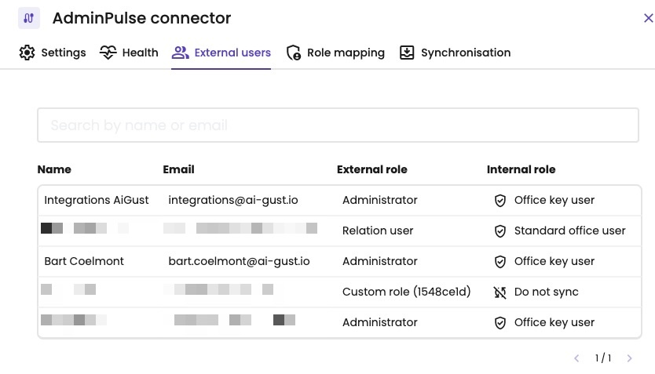
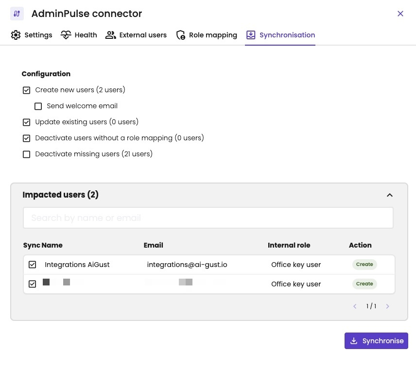

AdminPulse is a cloud platform for CRM and task management, used by many accounting firms. With the AdminPulse connector, you sync the users of your firm from AdminPulse to aiGust. You don't have to add them in aiGust one by one, and each user gets the aiGust role that matches their role in AdminPulse.

<Note>
This is a first version of the integration. It only syncs users: no administrations, figures or tasks.
</Note>

The sync isn't automatic. You run it yourself when you need it, for example when new colleagues joined your firm.

## Add the connector

You connect AdminPulse with an API key.

1. In AdminPulse, create an API key. See [Create the API key in AdminPulse](#create-the-api-key-in-adminpulse).
2. In aiGust, click **Settings** in the main rail, choose **Connectors**, and click **Add**.
3. Choose **AdminPulse**, and click **Next**.
4. Give the connector a **Name**, and paste the key in **API key**. Leave **API URL** empty: aiGust then uses the AdminPulse API.
5. Click **Create connector**.

<Frame caption="AdminPulse needs a name and an API key.">
  
</Frame>

### Create the API key in AdminPulse

1. In AdminPulse, go to **My profile** › **API keys**.
2. Create a new API key, and give it a clear **Name**, such as *aiGust*. It tells you later what the key is for.
3. Choose an **Expiry date** that matches how long you want to use the integration. When the key expires, the connector stops working until you enter a new key under **Settings**.
4. Under **Client**, choose **Own office integration**. aiGust isn't in the list yet.
5. Give the key only the permissions aiGust needs: **Read relations** and **Read users**.
6. Click **OK**, and copy the key.

<Frame caption="A new API key in AdminPulse.">
  
</Frame>

For more about API keys, see [Connect AdminPulse to other software](https://adminpulse.zendesk.com/hc/en-us/articles/8331100368924-Connect-AdminPulse-to-other-software-using-the-API-and-webhooks) in the AdminPulse help.

### Manage the connector

To manage the connector, open it: click **Settings** in the main rail, choose **Connectors**, and click the AdminPulse connector. It has the tabs **Settings**, **Health**, **External users**, **Role mapping** and **Synchronisation**. **Settings** and **Health** work as for every connector. See [Check a connector](/setup/data/connector-status).

## Map the roles

On **Role mapping**, choose for each AdminPulse role which aiGust role its users get: **Office key user** or **Standard office user**. Choose **Do not sync** to leave the users with that role out of aiGust, for example users who only register their time. See [Roles](/setup/users/roles).

<Frame caption="Each AdminPulse role, and the aiGust role its users get.">
  
</Frame>

Your changes aren't saved automatically. Save the role mapping after you change it.

## Check the users

**External users** lists the users aiGust found in AdminPulse, with their role in AdminPulse (**External role**) and the role they get in aiGust (**Internal role**). Users with **Do not sync** stay out of aiGust.

<Frame caption="The users in AdminPulse, and their role in aiGust.">
  
</Frame>

## Sync the users

1. Open the **Synchronisation** tab.
2. Under **Configuration**, choose what the sync does. Each option shows how many users it affects.
3. Under **Impacted users**, check the users and what happens to each of them. Clear **Sync** for a user to skip them this time.
4. Click **Synchronise**.

| Option | What it does |
|---|---|
| **Create new users** | Creates the users who are in AdminPulse but not in aiGust yet. Sending them the [welcome email](/setup/users/manage-users#the-welcome-email) is optional: turn on **Send welcome email** to do so. |
| **Update existing users** | Updates the users who are in both, but whose name or role differs between AdminPulse and aiGust. aiGust matches the users on their email address. |
| **Deactivate users without a role mapping** | Deactivates the aiGust users whose AdminPulse role is set to **Do not sync** on **Role mapping**. |
| **Deactivate missing users** | Deactivates the users who are in aiGust but not in AdminPulse. It doesn't delete them: you can activate them again. See [Manage users](/setup/users/manage-users#manage-users). |

<Warning>
**Deactivate missing users** also deactivates the users you added in aiGust yourself, if they're not in AdminPulse. Check the list under **Impacted users** before you click **Synchronise**.
</Warning>

<Frame caption="Two new users to create, without a welcome email.">
  
</Frame>

After the sync, the users appear under **Access** › **Internal users**. New users get access to all administrations. To limit what a user sees, see [Restrict administration access](/setup/users/restrict-access).
