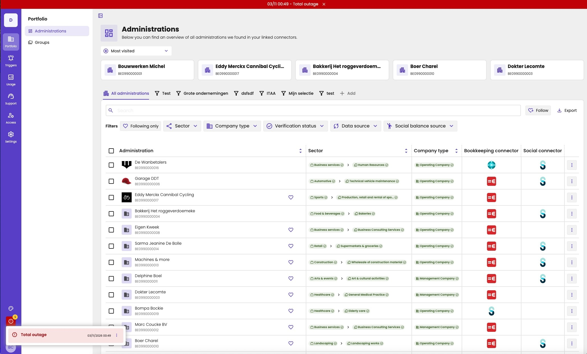

When part of aiGust is down, or doesn't work as it should, we warn you in the app itself. You know right away that we're on it, and you don't need to report it.

Everyone sees the notification: the users at your firm and your client users. If a problem only affects some firms, only their users see it.

## Types of notifications

| Type | Colour | When |
|---|---|---|
| **Critical** | Red | aiGust, or an important part of it, is down. |
| **Major** | Orange | A part of aiGust doesn't work as it should. |
| **Informational** | Blue | Something you should know, such as a known issue with a connector. |

## The banner at the top

A notification shows up as a banner in its colour at the very top of the screen, with its date, time and title.

Click **×** to close the banner. It goes away for you, and stays away. You can still read the notification from the main rail.

<Frame caption="A critical platform notification: the red banner at the top, and the notification opened from the red icon.">
  
</Frame>

## Read the notifications

As long as there are notifications, the main rail shows a red icon with an exclamation mark, just above your initials. You don't see it when there are none. The badge on it shows how many there are. Click the icon to read them, with their title, date and time.

A notification stays there until the aiGust team deactivates it, also when you closed the banner.

## When something doesn't work

If aiGust doesn't work as it should, check the notifications first. If there's one about your problem, there's no need to report it: we're already working on it.

If there's no notification about it, let us know:

- **Key users:** report it with the bug icon in the main rail. See [Report a bug](/setup/support/report-a-bug).
- **Everyone:** email [support@ai-gust.io](mailto:support@ai-gust.io).
